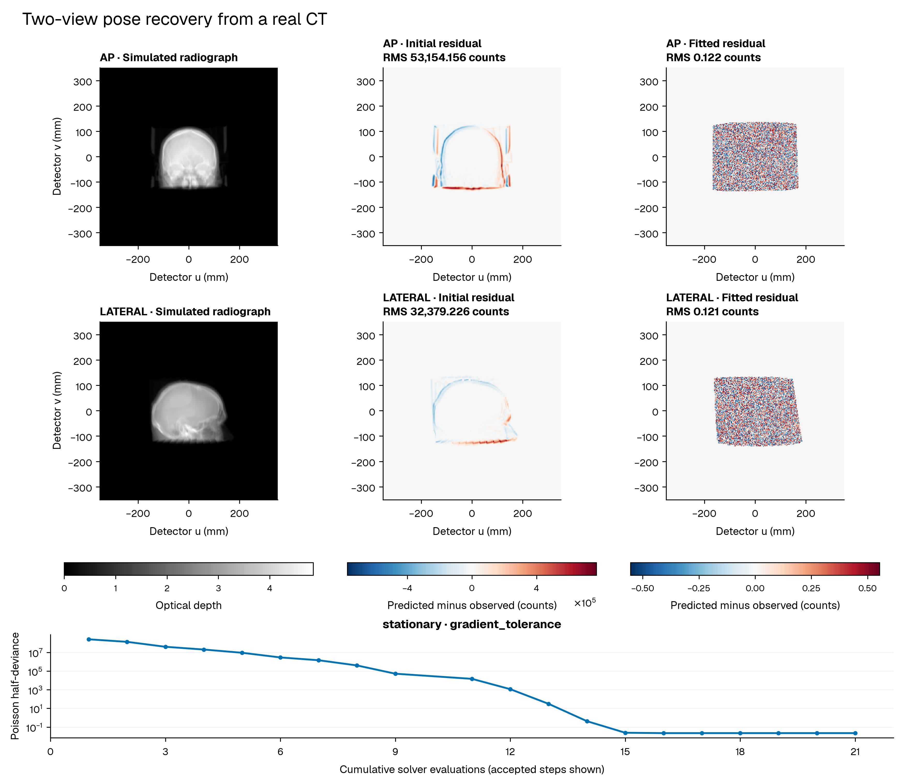

# Recover a CT pose from two images

An imaging agent has a CT volume, two calibrated radiographs and an initial object pose. Its task is to estimate the rigid transform that makes projections of the volume agree with both images.

The agent checks the inputs, calls a bounded fit and reads the result before deciding whether to stop. DPT renders the images and computes pose derivatives. The tool returns the estimated object-to-world transform, residuals for each view and the solver's termination reason.

## Use your CT

Pass a NIfTI file or a DICOM series directory:

```bash
python -m pip install '.[gpu,imaging,examples]'
python examples/agentic_imaging.py run scan.nii.gz --output outputs/ct-run
python examples/agentic_imaging.py run dicom-series/ --output outputs/dicom-run
```

The command prepares AP and lateral radiographs from the CT, inspects the case, fits the pose and assesses the result. It writes the prepared case to `case/` and the fitted results to `fit/` inside the output directory. CT values default to HU; voxel spacing, origin and orientation remain attached to the native volume.

Use `--series-uid UID` when a DICOM directory contains several image series. The loader lists the available UIDs if selection is needed. `--source` and `--rights` record optional source information and usage terms.

`--max-iterations` and `--max-evaluations` bound the fit. Each run needs a new output directory. The `prepare-ct`, `inspect`, `fit` and `assess` commands remain available for an agent to call separately.

For a CT and an existing radiograph, use the [single-image pose example](agentic-radiograph.md).

## Run the recorded example

This case uses the real Slicer CTBrain head CT. Its native grid has 512 × 507 × 76 voxels, with approximately 0.430 × 0.430 × 2.528 mm spacing. The complete volume retains its oblique orientation and native sampling.

The two radiographs are simulated from that CT. Generation and fitting use the same 60 keV water-scaled HU model, FP32 attenuation field, FP64 projection and 768 clipped midpoint samples per ray. The AP and lateral detectors each have 256 × 256 pixels with 2.7412 mm pitch.

Run the following from the source checkout with CUDA available:

```bash
python -m pip install '.[gpu,imaging,examples]'
python tools/download_samples.py brain --data-dir "$HOME/.cache/dpt/samples"
mkdir -p outputs

ct_source='Slicer CTBrain; https://github.com/Slicer/SlicerTestingData/releases/download/SHA256/6a5b6caccb76576a863beb095e3bfb910c50ca78f4c9bf043aa42f976cfa53d1'
ct_rights='Donated for unrestricted use; Slicer SampleData.py revision 4e1fdba309173e088d8467432a14c9d84f0313f7, line 88'

python examples/agentic_imaging.py prepare-ct \
  "$HOME/.cache/dpt/samples/CTBrain.nii.gz" --units HU \
  --source "$ct_source" --rights "$ct_rights" \
  --size 256 --samples-per-ray 768 \
  --output outputs/ct-case --device cuda:0

python examples/agentic_imaging.py inspect \
  --case outputs/ct-case/case.json

python examples/agentic_imaging.py fit \
  --case outputs/ct-case/case.json \
  --output outputs/ct-fit \
  --max-iterations 120 --max-evaluations 800 --device cuda:0

python examples/agentic_imaging.py assess \
  --run outputs/ct-fit \
  --reference outputs/ct-case/reference.json
```

Each successful command returns JSON. Choose new output directories for another run. The generating pose is stored separately and is read only by the final assessment.

The generating pose is the identity. The initial pose displaces the CT centre by `[3, -2, 1.5]` mm and rotates about that centre with axis-angle vector `[2, -1.5, 1]` degrees. The case records the resulting object-to-world transform and all detector coordinates.

Expected primary counts are rounded to integers, with an open beam of 1,000,000 counts per pixel. The simulation uses noise-free primary counts with fixed calibration and anatomy. The attenuation model is `max(1 + HU/1000, 0) * 0.02059 mm^-1`, a monoenergetic approximation.

## CT source and verification

The [Slicer testing-data mirror](https://github.com/Slicer/SlicerTestingData) supplies CTBrain. Slicer [documents unrestricted donor permission for CT-MR Brain](https://github.com/Slicer/Slicer/blob/4e1fdba309173e088d8467432a14c9d84f0313f7/Modules/Scripted/SampleData/SampleData.py#L88). The image data remain subject to those usage terms.

The downloader checks the source NRRD SHA-256, converts it to NIfTI and verifies every voxel value and the physical geometry. The recorded run used:

```text
CTBrain.nrrd
6a5b6caccb76576a863beb095e3bfb910c50ca78f4c9bf043aa42f976cfa53d1

CTBrain.nii.gz
da99b9b2175a5126f5d12e3c05633f677ce32ac85d7e068a53e62b1b420419e7
```

The source hash, voxel equality and physical-geometry checks identify the input. Downloaded CT data stay in the selected cache directory; generated case arrays and fit outputs go to `outputs`.

## Give the task to an agent

A coding agent with a terminal can use the same commands. Give it the case path and a bounded instruction:

> Inspect `outputs/ct-case/case.json`. Estimate the shared object-to-world pose from its two images. Make at most one fit call, with at most 120 solver iterations and 800 solver objective evaluations, plus two final per-view diagnostic evaluations. Write a new run directory. Read the result and both view residuals. Report the estimated rotation and translation, the termination reason and whether the solver reached stationarity. If an input is invalid or the solve remains unresolved, explain which check failed and stop. Keep the supplied volume, calibration, masks and initial pose unchanged. Use the generating-pose reference only after fitting, for assessment.

The tool sequence is `inspect`, `fit`, then `assess`. Input inspection runs before CUDA work. A failed hash or calibration check stops the task. A fit that reaches its budget remains unresolved, even if its loss fell. Another attempt needs an explicitly larger budget and a new output directory.

## Recorded CT result

The case ran on an NVIDIA GB10 with Warp 1.17.0 on 23 October 2026. The solver reached its gradient tolerance after 21 evaluations, followed by two final per-view diagnostic evaluations. The [saved result](../assets/results/agentic-imaging/ct-pose-recovery.json) contains the input hashes, conversion checks, full transforms and optimisation history.



The two residual columns use different colour scales. RMS values include all 65,536 detector pixels per view, including open-beam pixels. The fitted residuals are at the scale of count rounding.

| Quantity | Initial | Fitted |
|---|---:|---:|
| Summed Poisson half-deviance | 256,371,289.514 | 0.022349 |
| AP residual RMS, counts | 53,154.156 | 0.122345 |
| Lateral residual RMS, counts | 32,379.226 | 0.120608 |
| Geometric point RMS displacement, mm | 5.208004 | < 0.001 |
| Rotation error, degrees | 2.692582 | < 0.001 |

The eight geometric reference points lie at the 25% and 75% positions along each native grid dimension.

The run directory contains `summary.json`, `optimisation.json`, input configuration, device details, and initial and fitted predictions and residuals as NumPy arrays. Initial images are saved during the first counted solver evaluation. Assess a supplied case without known truth by omitting `--reference`.

Regenerate the figure from those saved outputs:

```bash
python tools/plot_agentic_imaging.py \
  --case outputs/ct-case/case.json --run outputs/ct-fit \
  --output outputs/ct-figures
```

The plotter writes PNG and PDF figures and a JSON record of its input hashes and display scales. The small analytic fixture remains available through `prepare-demo` for a quick smoke run.

## Supply a volume and two measured images

Use the [registration case schema](cases.md#registration). The case contains:

| Input | Required representation |
|---|---|
| Volume | Non-negative FP32 attenuation array in `mm^-1`, with grid shape, spacing, origin and orientation |
| Two images | FP32 arrays containing integer primary counts, with one calibrated detector geometry and positive open-beam count per image |
| Masks | Binary FP32 arrays; excluded observations are stored as zero |
| Initial pose | `registration.chart.anchor`: object-to-world rotation and translation in mm |
| Pose scales | Six positive scales: translation x/y/z in mm, then rotation x/y/z in radians |
| Input provenance | SHA-256, units, source and usage terms for each array |

The two views must share the same physical coordinate frame and contain calibrated primary counts. If the observations are calibrated transmission or optical depth, use the [Torch fitting example](../pytorch.md#optional-paired-data-fit) with the corresponding image quantity.

The fixed pose chart applies a local increment on the right of the anchor:

```text
object_to_world = anchor @ exp((scales * parameters)^)
```

Export the resulting transform. The optimiser parameters are dimensionless; multiplying them by the chart scales gives local tangent components in mm and radians. The reported world translation also depends on the rotation.

## Choose another view

Once a pose is available, the [acquisition-design driver](drivers.md#acquisition-design-results) can rank a supplied set of calibrated views. Its inputs include the fitted pose, target points in the volume's object frame, current pose precision, candidate geometries, exposures and a cost budget.

The driver computes each view's expected Poisson information and selects the view with the lowest mean target-position variance. An agent can use that result to request another view within the supplied constraints.
