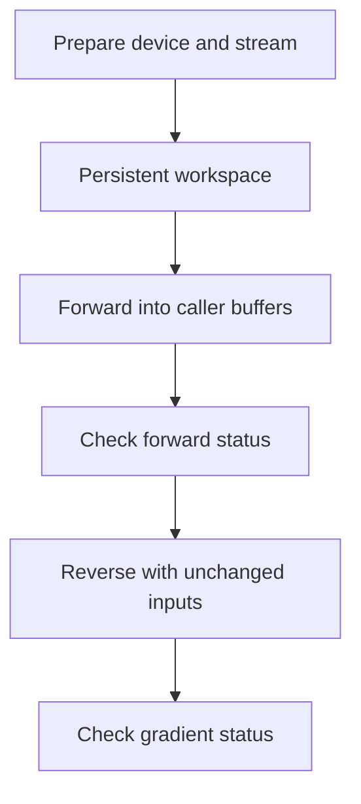

# Execution and ownership

Production operators separate preparation from evaluation. Preparation fixes metadata, device and stream, compiles the relevant Warp modules as needed and allocates persistent scratch. Evaluation receives typed device arrays and writes into caller-owned destinations.

## Prepare a workspace

Choose the physical specification, active parameters, precision and maximum problem size before creating a workspace. Use the same device for its inputs, scratch and outputs, and one owning stream on CUDA. A workspace is mutable execution state. Reuse it sequentially, or allocate distinct workspaces for concurrent and re-entrant work.

Host contracts import without NumPy, Warp or CUDA. Numerical operators require Warp and accept an explicit `device="cpu"` or an available CUDA device. CUDA is the default for low-level preparation. CPU execution owns no CUDA stream, so leave `stream=None`. A requested CUDA device must be available.

## Own arrays and streams

Arrays must have the declared dtype, shape, contiguous layout and device. Inputs, outputs, cotangents and gradient destinations must not overlap where the interface forbids aliasing. Supply flat buffers where the interface declares one-dimensional storage.

Allocate outputs yourself and keep all buffers alive until work on the owning stream completes. A call may enqueue work before returning. If an input is produced on another stream, establish the required ordering explicitly before DPT consumes it.

Prepared transport workspaces bind material IDs and coefficient tables. Keep these fixed for the workspace's lifetime. Dynamic density, source arrays and forward inputs must remain unchanged through completion. Forward inputs used by a VJP must also remain unchanged until the reverse evaluation completes.

## Check numerical completion

`validate=True` checks the declared numerical inputs and completes the relevant diagnostics before accepting a result. `validate=False` still checks interface metadata but permits deferred device validation. The caller must then call `workspace.check_status()` before accepting an output, loss or gradient.

Low-level workspace status is persistent. Checking it synchronises the owning stream and raises on failure without clearing the failure. Later launches retain earlier failure bits. Discard affected outputs after an error and call `clear_status()` only when deliberately beginning a new evaluation.

Composed evaluators and `FirstOrderPass` own their evaluation boundaries and can explicitly reset their workspaces on entry. Check pending low-level work before handing those workspaces to a new pass.

For a differentiable evaluation, keep forward inputs unchanged through reverse completion and all buffers alive until the owning stream completes:

## Interpret exceptions

| Exception | Meaning and response |
|---|---|
| `ContractError` | Fixed input, storage or interface contract is invalid. Repair it before evaluation |
| `TrialDomainError` | A proposed physical trial is outside the declared domain. A compatible recovery controller can reject it |
| `NumericalError` | Numerical failure. Preserve diagnostics and investigate |
| `GradientRangeError` | A requested transmission gradient cannot fit its FP32 destination. This is a numerical failure |
| `IncompleteHistoryError` | A transport resource guard stopped histories. Discard the entire estimate |

Some pose-chart and calibration-domain failures raise `NumericalError` and abort recovery. See [parameter recovery](../guides/recovery.md) for the affected checks.

## Precision is a storage contract

Results are rounded to the destination's storage precision. Choose retained precision at preparation and allocate matching buffers. Spectral coefficients, weights and response remain FP32 even when paths and image means are FP64. Conversions at incompatible boundaries must be explicit and checked.

Shared-parameter reductions use bounded scratch and FP64 arithmetic where declared. Field gradients can use FP32 atomic accumulation with scheduling-dependent summation order. Use tolerances appropriate to that reduction.

The [operator reference](../reference/operators.md) lists boundary-specific layouts. [Differentiation](../guides/differentiation.md) adds the reverse-pass ownership rules.
