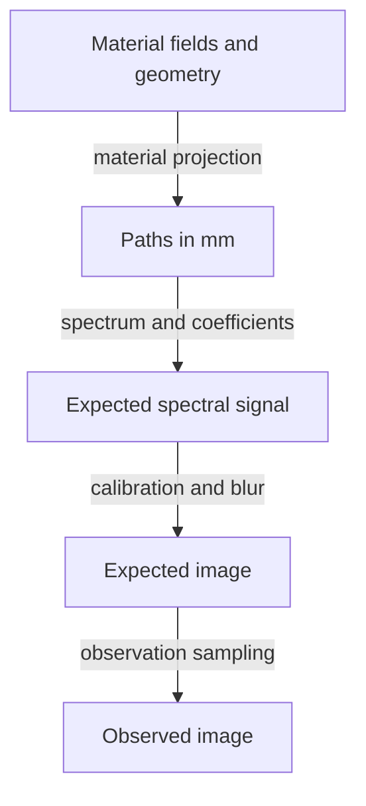

# The physical models

DPT provides deterministic primary imaging and stochastic photon transport. Primary imaging integrates sampled fields along detector rays. Transport traces photon histories through material cells, including scattering and absorption.

## Primary imaging

The deterministic projector integrates a sampled non-negative attenuation field along finite source-to-pixel segments. Attenuation is in mm⁻¹, length is in mm and the resulting optical depth is dimensionless. `GridSpec` defines a trilinearly interpolated field with a specific support convention. Midpoint and cell Gauss integration are two discretisations of this declared field.

Primary transmission follows Beer–Lambert attenuation and models removal from the primary beam through the supplied total attenuation coefficient. Photons scattered into detector pixels require the transport model. Multiplication by an open-beam count gives the expected primary count.

Material projection integrates dimensionless basis fields into path lengths in mm. The spectral operator then combines these paths with material attenuation coefficients and energy-bin populations. Supply the basis interpretation, mixing/density assumption and coefficient provenance, and convert CT values into the required attenuation or material representation before ingestion.

## Spectral and detector boundaries

The spectral mean is a sum of attenuated energy-bin contributions. An incident spectral density in photons/keV needs explicit integration weights in keV. Apply integration weights once when converting spectral density to bin populations. Detector response determines the output unit. The same shape can therefore hold a photon-count mean or an energy-weighted signal, with different observation models.

Calibration and blur are deterministic transformations of that mean. Poisson sampling, compound Poisson sampling and Gaussian read noise generate observations separately. Differentiate the expected measurement through the deterministic operators, and choose an objective matching the observation's measurement domain.

The spectral pipeline keeps the expected image and a sampled observation separate:

Fit the expected image to the supplied observation. Use observation sampling to simulate measurement noise.

## Photon transport

Transport uses an axis-aligned, piecewise-constant material grid. Supplied absorption and scattering coefficients define the macroscopic rates. The incoherent channel follows the declared isotropic elastic, free-electron Compton or [bound-electron Compton](../guides/bound-compton.md) law. Bound Compton uses shell occupancies, binding energies and momentum profiles to model Doppler broadening. [Physical interaction records](../guides/physical-transport.md) add a supplied Rayleigh partial and atomic form-factor law, single-vacancy fluorescence, local deposition and fixed-majorant tracking. Supply coefficient-energy tables covering the transported energies and retain each table's physical assumptions and provenance.

The caller supplies source positions, unit directions and non-negative importance weights. A history's detector score can include both uncollided and scattered photons. Adding a separate deterministic primary image to that estimate would count the uncollided contribution twice.

The analogue estimator samples absorption and scattering outcomes. Continuous absorption carries attenuation in the history weight whilst sampling scattering. The choice changes estimator variance and its derivative construction, although the intended expectation can be the same under the declared model.

The [readout interface](../guides/transport-readout.md) separates primary/scatter contributions and combines all descendants and detector connections before estimating a complete-history mean. [Randomised designs](../guides/transport-designs.md) retain complete sampling identities and estimate uncertainty across independent whole designs.

## Compare like quantities

| Comparison | Conditions needed |
|---|---|
| Deterministic transmission against an absorption-only transport mean | Equivalent physical support, coefficients, source rays and detector acceptance |
| Midpoint against cell Gauss projection | The same sampled field and geometry. The difference then measures quadrature error |
| Sampled-field projection against a continuous analytic field | Account for voxel discretisation as well as quadrature error |
| Monte Carlo signal against a measured image | Declared source normalisation, detector response, calibration, noise and model discrepancy |

The [first calculation](../getting-started/first-calculation.md) and [absorption-slab guide](../guides/transport.md) use analytic fixtures to show these models and their units in a small calculation.
