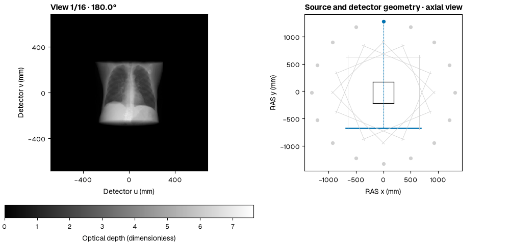
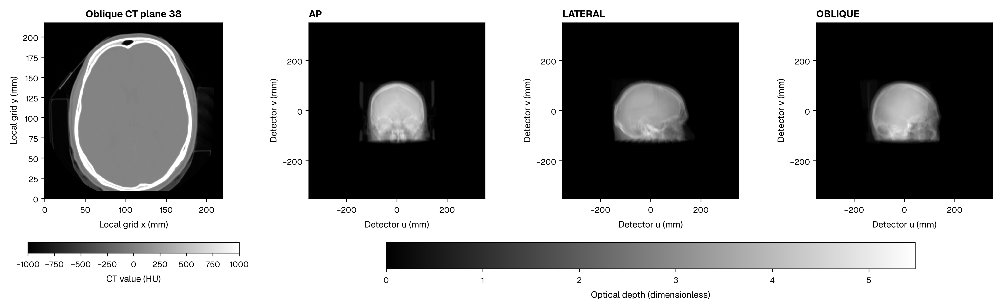

# NIfTI, DICOM and physical geometry

`read_volume(path, units=None, series_uid=None)` returns immutable values and a physical `GridSpec`. Values have shape `(z,y,x)`. Grid spacing is `(x,y,z)` in millimetres. The origin is the centre of sample `(0,0,0)`. Support extends half a sample beyond each outer centre.

## NIfTI

```python
import dpt
ct = dpt.read_volume("chest.nii.gz", units="HU")
mu = dpt.read_volume("calibrated_mu.nii.gz", units="mm^-1")
```

A coded sform takes priority over qform. Scaling is applied once. Complete oblique directions and translation are retained. Header spatial units are converted to millimetres. Left-handed input storage is reindexed without moving physical samples. Shear requires explicit resampling.

## DICOM

```bash
dpt project ./dicom-series --views ap --output projections
```

Known DICOM value units are read from the applicable value mapping. `--units HU` may declare missing units but cannot override a conflicting mapping. Slice positions, direction cosines, spacing and centre conventions are preserved. The public reader converts the full LPS frame to RAS.

For multiple image series, the reader reports the SeriesInstanceUID values, descriptions and file counts. Rerun with the chosen UID:

```bash
dpt project ./dicom-series --series-uid ACTUAL_UID_FROM_THIS_FOLDER --views ap --output projections
```

The reader loads one consistent image series. Compressed transfer syntaxes require the corresponding pydicom decoder.

## Standard views and explicit calibration

```python
views = dpt.standard_views(ct.grid, ("ap", "lateral", "oblique"), shape=(512, 512))
panel = views.views[0]
print(panel.source_mm, panel.origin_mm, panel.spacing_mm)
```

Standard AP places the source anterior (+RAS Y), lateral uses +RAS X, and oblique lies between them. Detector columns follow `u`. Rows follow `v`, towards superior (+RAS Z). The detector origin is pixel `(0,0)`'s centre. Returned positions and pitch are explicit millimetre values.

These example geometries cover the full physical support. For support diagonal D, SOD is `max(1000, 2D)` and SDD is `max(1500, 3D)`. Panel width is `1.05*D*SDD/(SOD-D/2)`. Use `dpt.geometry.DetectorGeometry` and `BatchedGeometry` for measured acquisitions.

Geometry/field sampling uses the same resolved sample count across precision comparisons. The default is 1024 clipped-midpoint samples per ray. A preparation-time `step_mm` option resolves to a count. Record that count when comparing algorithms.

See [coordinate mathematics](concepts/geometry.md), [batched geometry](guides/batched-geometry.md) and [the geometry API](reference/api-geometry.md).

## A measured view sweep



The sweep uses the native chest field and 1024 clipped midpoint samples per ray. Dots mark source positions. Line segments show detector panels. The rectangle is the volume support in the axial plane. The active source and panel are blue. [Static geometry](assets/figures/release-chest-512/acquisition_geometry.svg) and [four sample views](assets/figures/release-chest-512/view_sweep_samples.svg) are also available.

## Oblique brain geometry



The second sample retains its full oblique affine and native 512 × 507 × 76 voxel array. The CT panel uses local in-plane millimetres. The 511 × 769 detector exercises the odd image dimensions reported in the performance table.
