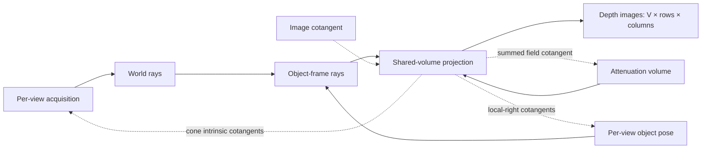

# Build a multiview acquisition

`BatchedGeometry` stores one compact panel description per view. Device preparation expands those descriptions into finite ray segments, with optical-depth outputs flattened in view, row, column order. The host describes the panels. The device generates the pixels.

## Describe circular cone views

```python
import math

from dpt.geometry import BatchedGeometry, ConeBeamIntrinsics

intrinsics = ConeBeamIntrinsics(
    source_object_distance_mm=10.0,
    source_detector_distance_mm=20.0,
    shape=(2, 3), spacing_mm=(0.5, 0.5),
)
batch_geometry = intrinsics.batch((0.0, math.pi / 2))
assert batch_geometry.shape == (2, 2, 3)
assert batch_geometry.pixels == 12
assert batch_geometry.view_offsets == (0, 6, 12)

astra_geometry = batch_geometry.to_astra_vectors()
restored = BatchedGeometry.from_astra_vectors(astra_geometry)
assert restored.shape == batch_geometry.shape
```

Distances, offsets and pixel spacings are in millimetres. Angles are in radians. Shapes are `(rows, columns)`, while spacings and detector offsets are `(column, row)`. At zero angle, the source lies on negative world y and the detector lies on positive y. Circular views rotate around world z. A one-row panel gives a fan-beam acquisition.

A batch may combine flat cone, parallel and cylindrical panels with the same `(rows, columns)` shape. `ParallelGeometry` supplies a unit direction and a finite source-to-panel length. `CurvedDetectorGeometry` uses column spacing as arc length around its source-centred cylinder. Pixel (0, 0) is the supplied panel origin.

## Project and differentiate per-view motion

For object-to-world transforms `(R[v], t[v])`, world ray endpoints become

```text
s_object[v] = R[v].T @ (s_world[v] - t[v])
e_object[v] = R[v].T @ (e_world[v] - t[v])
```

`prepare_cone_projection` binds circular cone views and their calibration. Each forward accepts one shared attenuation volume and a contiguous FP64 pose array of shape `(views, 12)`. Each row contains the object-to-world rotation in row-major order, followed by translation in mm.

This complete CUDA example projects two differently posed acquisitions. It then differentiates the sum of their optical depths with respect to each pose, each view's cone calibration and the shared volume:

```python
import math

import warp as wp

from dpt.batched_projection import (
    batched_projection_vjp, prepare_cone_projection, project_batched_optical_depth,
)
from dpt.geometry import ConeBeamIntrinsics, RigidTransform, compose_pose
from dpt.projection import ProjectionSpec
from dpt.volumes import GridSpec

device = "cuda:0"
grid = GridSpec((3, 4, 5), (0.6, 0.7, 0.8), (-1.2, -1.05, -0.8))
intrinsics = ConeBeamIntrinsics(8.0, 20.0, (2, 3), (0.4, 0.5), (0.1, -0.2))
angles = (0.2, 1.1)
workspace = prepare_cone_projection(
    grid, intrinsics, angles,
    ProjectionSpec(48, precision="float64", active_volume=True, active_pose=True),
    active_intrinsics=True, device=device,
)
values = [
    0.02 + 0.001 * x + 0.002 * y + 0.003 * z
    for z in range(3) for y in range(4) for x in range(5)
]
mu = wp.array(values, dtype=wp.float32, device=device)
pose_records = (
    RigidTransform(),
    compose_pose(RigidTransform(), (0.05, -0.04, 0.02, 0.02, -0.03, 0.01)),
)
poses = wp.array(
    tuple(pose.packed() for pose in pose_records), dtype=wp.float64, ndim=2, device=device,
)
depth = wp.empty(workspace.geometry.shape, dtype=wp.float64, device=device)
cotangent = wp.ones(workspace.geometry.shape, dtype=wp.float64, device=device)
pose_gradient = wp.empty((2, 6), dtype=wp.float64, device=device)
intrinsic_gradient = wp.empty((2, 4), dtype=wp.float64, device=device)
volume_gradient = wp.empty(grid.voxels, dtype=wp.float64, device=device)

project_batched_optical_depth(mu, poses, workspace=workspace, out_L=depth)
batched_projection_vjp(
    mu, poses, cotangent=cotangent, workspace=workspace,
    out_pose_tangent=pose_gradient, out_intrinsics=intrinsic_gradient, out_mu=volume_gradient,
    volume_gradient_precision="float64",
)
assert depth.shape == (2, 2, 3)
for array in (depth, pose_gradient, intrinsic_gradient, volume_gradient):
    assert all(math.isfinite(float(value)) for value in array.numpy().flat)
```

`mu` is a flat, x-fastest attenuation field in mm⁻¹. Optical depth and its cotangent have shape `(views, rows, columns)` and the retained projection precision. The `.numpy()` calls above explicitly read back the arrays for the example's assertions.

The derivative destinations have distinct coordinate meanings:

| Destination | Shape and storage | Coordinates |
|---|---|---|
| `out_pose_tangent` | `(V, 6)`, FP64 | Local-right `(tx, ty, tz, rx, ry, rz)` for each supplied pose |
| `out_intrinsics` | `(V, 4)`, FP64 | SOD, SDD, column offset, row offset, all in mm |
| `out_mu` | `(voxels,)`, FP32 or FP64 | Shared attenuation field, contributions summed across views |

Pose translations use mm and rotations use radians. Their cotangents are derivatives per mm and per radian. Intrinsic cotangents are derivatives per mm. A fixed-anchor pose optimiser converts the local-right cotangent with `geometry.chart_gradient`, as described in [the geometry conventions](../concepts/geometry.md).

One `ConeBeamIntrinsics` record supplies shared calibration. A tuple supplies one record per angle. The intrinsic VJP always returns one row per view, so sum its rows to differentiate a shared calibration. Panel shape, pixel spacing and acquisition angles are fixed. Prepare a new workspace when those records change.

`active_pose`, `active_volume` and `active_intrinsics` select the supported derivatives. Pose and intrinsic derivatives use strict FP64 sampling with midpoint or cell-Gauss integration. Use `prepare_batched_projection` for an existing flat, parallel or curved `BatchedGeometry`, and `prepare_cone_projection` for active circular-cone calibration.



## Own rays and execution storage

Preparation transfers eighteen FP64 values and one mode flag per view, then generates the source/end arrays on the owning stream. The batched workspace retains world and object-frame rays, derivative scratch and fixed per-view reductions. `max_bytes`, defaulting to 256 MiB, bounds its resident geometry and scratch. The shared attenuation field and caller-owned outputs sit outside that workspace budget.

Reuse a workspace sequentially. Each forward and VJP regenerates object-frame rays from the supplied poses, so reverse evaluation uses its current arguments. For the derivative of a particular forward, supply that forward's unchanged field and poses with its image cotangent. Outputs and cotangents must have the declared contiguous layouts and share the workspace's device and owning stream. Keep all arrays alive through completion.

`validate=True` checks current inputs and numerical completion. For `validate=False`, complete `workspace.check_status()` before accepting the images or gradients. VJPs overwrite destinations by default. Select `accumulate=True` when deliberately adding another contribution.

For direct ray access, `prepare_geometry(batch_geometry)` returns a `DeviceRayBundleGeometry`. Its `in_object_frame(poses)` method returns transformed rays using the mapping above. Reuse a destination with `out=previous_rays`. `validate_poses(poses)` provides an explicit pose checkpoint before repeated transforms with `validate=False`.

`projection_ray_vjp` writes FP64 `(pixels, 6)` cotangents for source x/y/z and endpoint x/y/z. It includes finite segment clipping, sample motion and segment length, providing the acquisition-coordinate reverse product used by cone calibration.

## Exchange ASTRA vector geometry

`to_astra_vectors()` exports uniformly flat cone views as `cone_vec` and uniformly parallel views as `parallel3d_vec`. Its `(views, 12)` rows contain source/direction, panel centre, column pixel vector and row pixel vector. DPT's first-pixel origin is converted to ASTRA's panel centre.

`from_astra_vectors(..., length_scale_mm=...)` declares the length conversion. Parallel imports also require `parallel_length_mm`, because DPT integrates finite segments. Curved or mixed panel batches keep their native DPT description.

## Recover a metric detector from a projection matrix

`ProjectionMatrix` maps world coordinates in mm to homogeneous column, row and depth coordinates. `project(point_mm)` returns continuous `(row, column)` indices at pixel centres. To recover finite physical rays, supply the panel shape, perpendicular source-to-panel distance and a known point in the intended source-to-panel hemisphere.

This host example round-trips a 20 mm source-to-panel geometry:

```python
import math

from dpt.geometry import DetectorGeometry
from dpt.projective import ProjectionMatrix

panel = DetectorGeometry(
    (-10.0, 0.0, 0.0), (10.0, -0.5, -1.0),
    (0.0, 1.0, 0.0), (0.0, 0.0, 1.0), (0.5, 1.0), (3, 3),
)
matrix = ProjectionMatrix.from_detector(panel)
recovered = matrix.to_detector(
    shape=panel.shape, detector_distance_mm=20.0,
    positive_depth_point_mm=(0.0, 0.0, 0.0),
)
assert math.dist(recovered.source_mm, panel.source_mm) < 1e-12
assert math.dist(recovered.origin_mm, panel.origin_mm) < 1e-12
row, column = matrix.project(panel.pixel_centre(2, 1))
assert math.isclose(row, 2.0, abs_tol=1e-12)
assert math.isclose(column, 1.0, abs_tol=1e-12)
```

The matrix fixes ray lines. The supplied distance fixes their metric detector spacing, and the positive-depth anchor fixes the physical hemisphere under homogeneous sign changes. For an oblique source, perpendicular panel distance differs from the source-to-panel-centre segment length. This interface describes perspective cameras with orthogonal detector axes.

## Exchange TIGRE cone geometry

`TigreConeGeometry` is an immutable host record for TIGRE's cone acquisition, including tilted panels and ZYZ acquisition angles. Its names make the native layouts explicit:

| Quantity | TIGRE convention |
|---|---|
| Physical frame at zero angle | Source on +X, columns increasing +Y, Python output rows increasing +Z |
| Detector shape and spacing | `(rows, columns)` |
| Acquisition angles | `(alpha, theta, psi)`, applying `Rz(alpha) Ry(theta) Rz(psi)` |
| `rotDetector` | `(rx, ry, rz)`, applying `Rz(rz) Ry(ry) Rx(rx)` |
| `offOrigin` | `(Z, Y, X)` in mm |
| `offDetector` | `(V, U)` in mm, row then column |
| `COR` | Transverse centre-of-rotation correction in mm |

Distances and offsets use mm. Angles use radians. `world_from_tigre` declares the rigid map into your DPT world frame. The following host example includes detector tilt, origin offsets and centre-of-rotation correction:

```python
import math

from dpt.geometry import RigidTransform
from dpt.tigre_geometry import TigreConeGeometry

tigre_record = TigreConeGeometry(
    shape=(2, 3), spacing_rows_columns_mm=(0.5, 0.4),
    source_object_distance_mm=(8.0, 9.0), source_detector_distance_mm=(20.0, 22.0),
    angles_rad=((0.2, 0.0, 0.0), (1.1, 0.1, -0.02)),
    detector_offset_rows_columns_mm=((-0.2, 0.1), (-0.1, 0.3)),
    detector_rotation_xyz_rad=((0.02, -0.01, 0.03), (0.0, 0.0, 0.0)),
    origin_offset_zyx_mm=((0.1, -0.2, 0.3), (0.1, -0.2, 0.3)),
    centre_rotation_mm=(0.05, 0.05),
)
world_from_tigre = RigidTransform(rotation=(0.0, 1.0, 0.0, -1.0, 0.0, 0.0, 0.0, 0.0, 1.0))
panels = tigre_record.to_dpt(world_from_tigre=world_from_tigre)
roundtrip = TigreConeGeometry.from_dpt(
    panels, angles_rad=tigre_record.angles_rad, world_from_tigre=world_from_tigre,
    origin_offset_zyx_mm=tigre_record.origin_offset_zyx_mm,
    centre_rotation_mm=tigre_record.centre_rotation_mm,
)
for view in range(2):
    original_ray = panels.segment(view, 1, 2)
    recovered_ray = roundtrip.to_dpt(world_from_tigre=world_from_tigre).segment(view, 1, 2)
    assert all(math.dist(a, b) < 1e-12 for a, b in zip(original_ray, recovered_ray, strict=True))
```

Import an existing native geometry with `TigreConeGeometry.from_tigre(geometry, angles)`. Export to a new native geometry with `to_tigre()`, which loads NumPy and TIGRE when called and creates owned arrays:

```pycon
>>> native_geometry, native_angles = tigre_record.to_tigre()
>>> imported = TigreConeGeometry.from_tigre(native_geometry, native_angles)
>>> assert imported.shape == tigre_record.shape
>>> assert imported.angles_rad == tigre_record.angles_rad
```

Set TIGRE's volume discretisation (`nVoxel`, `dVoxel`, `sVoxel`) before calling its projector. DPT export from a panel batch uses the supplied acquisition angles, origin offsets and `COR` to determine the source orbit. The explicit frame and layouts keep detector rows, columns and offsets consistent throughout the exchange.
