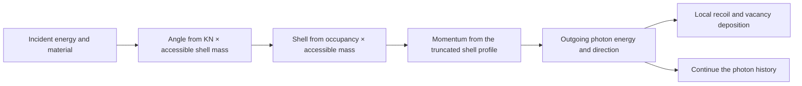

# Bound Compton scattering

An electron in an atom has momentum before a photon reaches it. Its binding energy also limits the energy available after the collision. Together, these effects broaden the outgoing photon energy around the stationary-electron Compton result. Select `scattering_law="bound-electron-compton"` to include them in the material-cell walker.

DPT uses an independent-atom relativistic impulse model with analytical Hartree–Fock shell profiles. Each occupied shell supplies its electron count, ionisation energy and per-electron profile height at zero momentum. Angle, shell and outgoing photon energy are sampled from the same joint law. The model takes the leading impulse approximation, `F(p) = 1`: the analytical momentum profile and shell binding determine the broadening, with unit weight for the additional impulse correction.

## Bind shell data to transport

Install the transport and physical-data dependencies:

```bash
python -m pip install '.[warp,physical-data]'
```

`xraylib_bound_compton(Z)` loads the shell profile heights and binding energies from xraylib 4.3.0. Its electron counts come from the matching Biggs profile configuration bundled with DPT. This distinction matters: xraylib's `ElectronConfig` describes a different atomic configuration, so combining it with the Biggs profiles changes the shell mixture.

The following CPU calculation sends 128 photons through a 1 mm aluminium slab and checks its energy ledger. Shell and angular data come from xraylib. The supplied macroscopic absorption and scattering rates are synthetic values in mm⁻¹. Replace these rates with your material's coefficients when modelling an experiment.

```python
import numpy as np
import warp as wp

from dpt.transport import (
    HistoryBatch, MaterialGrid, PhysicalTransport, PlanarDetector, TransportSpec,
    trace_energy_balance, xraylib_atomic_scattering, xraylib_bound_compton,
)
from dpt.transport.forward import prepare_transport

device, count = "cpu", 128
shells = xraylib_bound_compton(13)
atomic = xraylib_atomic_scattering(13, tuple(np.linspace(0.0, 7.0, 129)))
physical = PhysicalTransport(
    scattering_tables=(atomic,),
    rayleigh_mm_inverse=(0.0, 0.0),
    cutoff_kev=0.1,
    bound_compton=(shells,),
)
transport = prepare_transport(
    TransportSpec(
        MaterialGrid((-1.0, -1.0, 0.0), (2.0, 2.0, 1.0), (1, 1, 1), 1),
        PlanarDetector((-1.0, -1.0), (2.0, 2.0), (1, 1), 2.0),
        80.0, "Aluminium slab with specified macroscopic rates",
        estimator="analogue",
        scattering_law="bound-electron-compton",
        coefficient_energies_kev=(0.1, 80.0),
        energy_support_policy="runtime-guard",
    ),
    material_ids=wp.array([0], dtype=wp.int32, device=device),
    absorption=wp.array([0.0, 0.0], dtype=wp.float64, device=device),
    scattering=wp.array([0.3, 0.3], dtype=wp.float64, device=device),
    physical=physical, max_histories=count, device=device,
)
assert transport.physical.bound_compton[0].atomic_number == 13

initial = wp.empty(count, dtype=wp.float64, device=device)
deposited = wp.empty(count, dtype=wp.float64, device=device)
final = wp.empty(count, dtype=wp.float64, device=device)
local = wp.empty(1, dtype=wp.float64, device=device)
events = wp.empty(count, dtype=wp.int32, device=device)
trace_energy_balance(
    wp.array([(0.0, 0.0, -1.0)] * count, dtype=wp.vec3d, device=device),
    wp.array([(0.0, 0.0, 1.0)] * count, dtype=wp.vec3d, device=device),
    wp.ones(count, dtype=wp.float64, device=device),
    wp.ones(1, dtype=wp.float64, device=device),
    batch=HistoryBatch(41, 0, count), workspace=transport,
    out_pixel=wp.empty(count, dtype=wp.int32, device=device),
    out_score=wp.empty(count, dtype=wp.float64, device=device),
    out_energy=final, out_events=events,
    out_status=wp.empty(count, dtype=wp.int32, device=device),
    out_initial_energy=initial, out_deposited_energy=deposited,
    out_spectrum_index=wp.empty(count, dtype=wp.int32, device=device),
    out_local_deposition=local,
)
np.testing.assert_allclose(initial.numpy(), 80.0, rtol=0, atol=0)
np.testing.assert_allclose(initial.numpy(), final.numpy() + deposited.numpy(), rtol=0, atol=1e-12)
assert np.any(events.numpy() > 0)
assert np.any(deposited.numpy() > 0)
assert np.isclose(float(local.numpy()[0]), deposited.numpy().sum())
```

Each energy output is a contiguous FP64 array of shape `(128,)` in keV. The single-cell local tally has shape `(1,)` and includes source importance weights and amplitude. Positions and directions use FP64 three-vectors. Material IDs and event counts use int32. The arrays are caller-owned and reside on the selected device. The example uses unit weights, so the local tally equals total deposited energy. Divide it by 128 to obtain mean deposition per original history.

The prepared workspace also supports [photon histories](transport.md) and [detector scores](transport-readout.md). Macroscopic absorption and scattering determine interaction rates. The shell table determines the conditional final state of an incoherent scattering event. Keep the default `compton_sampler` when selecting `bound-electron-compton`. That law selects its own impulse sampler.

Supply one `BoundComptonTable` per material, containing every occupied shell with electron counts summing to its atomic number. The atomic angular table and shell table must describe the same element. Each `ComptonShell` gives a shell name, occupancy, binding energy in keV and per-electron zero-momentum profile height in inverse atomic units. A supplied table needs a `Provenance` record identifying those physical data.

The provider helper requires binding and profile data for every occupied shell. For example, xraylib 4.3.0 has no N1 binding energy for the Biggs iron configuration. Calling `xraylib_bound_compton(26)` therefore raises `TransportError` during preparation. To model that element, construct a complete `BoundComptonTable` from a dataset that supplies the missing binding energy and the matching shell profiles and occupancies. Retain that dataset's provenance in the table.

Incident photon energies lie between 0.1 and 5000 keV. Set `cutoff_kev` to at least 0.1 keV and provide coefficient support down to that cutoff. Transport deposits the complete residual photon energy before looking up a rate below the cutoff. Select `energy_support_policy="runtime-guard"`: the momentum profile permits outgoing photon energies arbitrarily close to zero, so the cutoff completes the model's finite coefficient support.

## The joint angle and energy law

Let `E` and `E'` be incident and outgoing photon energies in keV, `c = cos(theta)`, `r = E'/E`, and `m = m_e c_light²`, the electron rest energy. The dimensionless longitudinal momentum `p` is measured in units of `m_e c_light`:

```text
A = 1 + (E/m)(1-c)
q = sqrt((1-r)² + 2r(1-c))
p = (Ar-1)/q
```

For shell `i`, let `h_i = J_i(0)/alpha`, where `J_i(0)` is its tabulated per-electron profile height in inverse atomic units and `alpha` is the fine-structure constant. The normalised analytical profile is

```text
J_i(p) = h_i(1 + 2h_i|p|) exp(-2h_i|p| - 2h_i²p²)
F(p)   = 1
```

The profile extends over the full real line. Binding energy `U_i` restricts a collision to `0 < E' < E-U_i`, equivalent to `-1 < p < p(E-U_i)`. Here `p(E-U_i)` means the momentum relation above evaluated at outgoing energy `E-U_i`. Shells with `E <= U_i` contribute zero accessible mass. For the remaining shells, the angular weight is

```text
w(E,c) = KN(E,c) sum_i f_i integral[-1, p(E-U_i)] J_i(p) dp
```

The occupancy is `f_i`. The unpolarised Klein–Nishina factor is `KN(E,c) = tau²(tau + 1/tau - 1 + c²)`, with `tau = 1/A`. Its constant factor cancels on normalisation. With `N(E) = 2pi integral[-1, 1] w(E,c) dc`, the joint density per steradian per keV is

```text
P(c,E' | E) = KN(E,c)/N(E)
             × sum_i f_i J_i(p) indicator(0 < E' < E-U_i)
             × (A-c+r(1-Ac))/(E q³)
```

The final factor is the momentum-to-energy Jacobian. The sampler first draws the angle from its accessible shell mixture, then draws a shell and momentum conditional on that angle. It uses the accessible mass at backscatter as its rejection envelope, preserving the conditional law when low-energy accessibility is small. Energy inversion enforces the binding limit. With zero initial electron momentum and zero binding, the relation reduces to the stationary-electron Compton result.



## Scores, next-event connections and replay

Density, coefficient and source-spectrum derivatives keep the physical shell data fixed. A Compton collision deposits `E-E'` locally: `U_i` belongs to the vacancy and the remainder to the recoil electron. The [analogue energy ledger](physical-transport.md#trace-a-complete-energy-ledger) accounts for both in FP64 keV.

Next-event estimation uses the same normalised angular marginal and an independently addressed conditional shell/energy draw. `bound_compton_joint_pdf` evaluates the combined density when supplied with `solid_angle_normalisation=N(E)`. `bound_compton_joint_scores` returns interior log-density derivatives in cosine and outgoing energy, holding the other arguments fixed. The outgoing-energy derivative has units keV⁻¹. Supply `normalisation_energy_score=d(log N)/dE` to obtain a third derivative in incident energy for chained collision states. An exact incident shell threshold `E=U_i` is a kink. Requesting that incident-energy score raises `TransportError`. Derivatives of moving shell support also include the boundary contribution alongside these interior scores.

Complete randomised designs use `SamplingDesign(..., layout="bound-compton-v3")`, with `16 + 6*max_angle_trials` coordinates per event and descendant. The layout assigns separate coordinates to the trajectory's shell and momentum and the next-event shell and momentum. Use the same declared layout and history identity for replay. [complete sampling designs](transport-designs.md) explains event budgets and uncertainty from independent randomised replicates.

## Scientific references

- [Brusa et al. (1996), Fast sampling algorithm for the simulation of photon Compton scattering](https://doi.org/10.1016/0168-9002(96)00652-3), [PENELOPE Compton model and impulse approximation](https://geant4.web.cern.ch/documentation/pipelines/master/prm_html/PhysicsReferenceManual/electromagnetic/gamma_incident/compton/penelope_compton.html).
- [Pinned xraylib Biggs profile data](https://github.com/tschoonj/xraylib/blob/xraylib-4.3.0/data/comptonprofiles.dat), [xraylib BSD licence](https://github.com/tschoonj/xraylib/blob/xraylib-4.3.0/license_all.txt).
