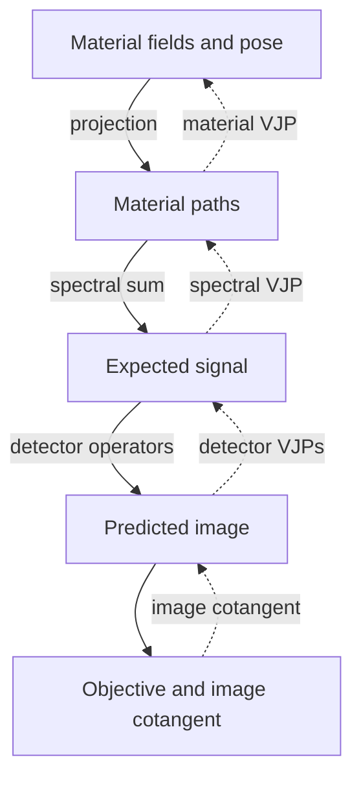

# Differentiating a calculation

DPT computes first-order derivatives through vector–Jacobian products (VJPs). Supply the derivative of your objective with respect to an operator's output, and its VJP returns derivatives with respect to the active inputs. Projection and transmission also support Warp tape recording.

This guide explains how to compose those derivatives and keep their inputs alive through the reverse pass. Use the [operator reference](../reference/operators.md) to check layouts and dtypes. Native operators accept explicit CPU or CUDA execution with the `warp` extra. Keep each composition on its prepared device.

## Compose explicit VJPs

For a deterministic composition, evaluate the forward operators, obtain the objective's derivative with respect to the predicted image, then apply the operators' VJPs in reverse order. That output derivative is the cotangent. The objective writes it into caller-owned storage.

A material/spectral composition follows this sequence:

1. Project bound material fields into material-major path lengths.
2. Evaluate the spectral mean and any declared detector response.
3. Evaluate the objective and request its prediction cotangent.
4. Apply detector transposes/VJPs, then `spectral_vjp` to obtain path cotangents.
5. Apply `material_projection_vjp` to obtain pose or material-field cotangents.

Solid arrows carry forward values. Dashed arrows carry cotangents back through the same composition:



Keep the original forward inputs unchanged until reverse evaluation completes. Spectral and projection VJPs recompute the necessary quantities from those inputs. Replacing a field or coefficient array between forward and reverse changes the differentiated map.

Most explicit VJPs overwrite their destinations and preserve supplied cotangents. Projection and material projection expose `accumulate` for deliberate accumulation across contributions. Transmission's private accumulation argument belongs to its tape adapter. Shared spectral and calibration parameters use FP64 reductions. Projection and aperture field gradients scatter into FP32 or FP64 destinations using atomics, whose summation order is not deterministic. `projection_adjoint_gather` instead gathers each field gradient deterministically in FP64.

Use `cotangent=` for an operator's output derivative and `out_cotangent=` when requesting an objective's prediction derivative. A cotangent has the output's shape, dtype and device. Random samplers instead take an integer `seed` that identifies their random experiment.

Transmission has several outputs: use `cotangent_T`, `cotangent_counts`,
`cotangent_log_T` and `cotangent_removed` to select their reverse contributions.
`evaluate_primary_objective(out_depth_cotangent=...)` writes the objective's
derivative with respect to optical depth. Material projection instead binds
its material-major reverse input as `cotangent_paths` during preparation.

## Tape support is explicit

These calls illustrate tape recording with workspaces and buffers prepared beforehand:

```python
project_optical_depth(mu, pose, workspace=projection, out_L=depth, tape=pass_.tape)
transmit(depth, beam, workspace=transmission, out_counts=counts, tape=pass_.tape)
optical_depth_from_removed(delta, out_L=depth, workspace=transmission, tape=pass_.tape)
```

Allocate participating outputs and active inputs with `requires_grad=True` before recording. An output's gradient buffer is part of the storage contract. Pass the active tape explicitly, and keep primal buffers separate from gradient storage. The workspace's activity flags determine which inputs are differentiated.

Compose the explicit VJPs for spectral, material-projection, detector and objective interfaces. These reject ambient tape recording. `evaluate_objective` writes the prediction derivative into `out_cotangent` for use as the reverse-pass cotangent.

These adapters support first-order differentiation only.

## Own one forward/reverse pass

`FirstOrderPass(workspaces)` owns one tape recording and its diagnostic checkpoint. The intended lifetime is:

1. Check any pending work from a preceding evaluation before entering the pass. Entry explicitly clears the listed workspaces' statuses for the new evaluation.
2. Enter the pass as a context manager and record supported forward operators with its `.tape`.
3. Exit the recording context before calling `pass_.backward(output, cotangent=cotangent)`.
4. Read or use active-input gradient buffers after backward succeeds, then call `pass_.close()`.

`backward` requires an output with a preallocated gradient and a cotangent matching its dtype, device and shape. It seeds the tape and checks all listed workspaces after the custom reverse callbacks. `close` zeros accumulated cotangents, resets the tape and releases abandoned projection recordings. Copy any gradient that must survive closure. A closed pass cannot be re-entered: create another `FirstOrderPass` for the next evaluation.

A projection workspace permits one outstanding recorded forward. Use distinct workspaces for concurrent or re-entrant evaluations. Keep every participating buffer alive until completion on the owning stream. Cross-stream ordering remains the caller's responsibility, as described in the [execution contract](../concepts/execution.md).

## Pose gradients have two coordinate systems

The pose buffer contains twelve FP64 values: the nine row-major rotation entries followed by translation x/y/z. `projection_vjp` can write either `out_pose_tangent`, a six-coordinate cotangent for a local right SE(3) increment, or `out_pose_matrix`, twelve unconstrained storage partials. The tangent order is translation x/y/z followed by rotation x/y/z. Choose one destination per call.

The tape adapter uses the twelve storage partials for its chain rule. A six-coordinate optimiser requires the local-right cotangent, and a fixed-anchor chart requires conversion with `geometry.chart_gradient`. The [geometry page](../concepts/geometry.md) defines the transform direction and chart conventions.

Projection derivatives follow the chosen discrete quadrature and include active intersection bounds. At interpolation knots, grazing rays and tied intersections, the forward map can be non-differentiable and the operator returns the selected branch's derivative. Grid and acquisition calibration derivatives are outside this interface's contract.

## Numerical completion and stochastic derivatives

Checked calls validate current device contents. `validate=False` retains metadata checks but defers numerical completion to `workspace.check_status()`. Status persists across checks and later operators until explicitly cleared. Check before accepting a loss or gradient. After failure, discard affected outputs and clear status only at an explicit new-evaluation boundary.

`TrialDomainError` identifies a rejectable physical trial. `ContractError` identifies invalid fixed inputs or interface use. Other `NumericalError` exceptions, including transmission's `GradientRangeError`, abort recovery. A non-finite gradient raises `NumericalError`.

Transport derivatives estimate derivatives of expected detector scores using the declared flight law and derivative measure. Replaying a seeded trace supplies matching paths for likelihood and explicit weight derivatives. A zero-hit sample can produce a zero gradient, so stochastic recovery uses uncertainty estimates and held-out checks. The complete callable boundaries are listed in the [API reference](../reference/api.md).
