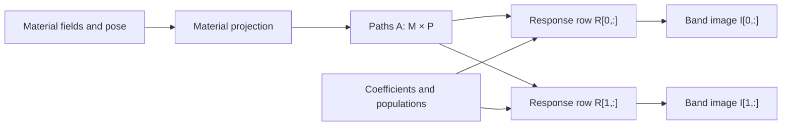

# Compose material projection and a spectrum

`SpectralPipeline` combines material-path projection with polychromatic signal formation. Prepare the spectrum, attenuation coefficients and detector response once, then evaluate changing material fields and poses through one retained interface.

For dimensionless material fields `f[m]`, path lengths are

```text
A[m,p] = integral f[m](r_p(s)) ds                         [mm]
I[p]   = sum_k w[k,p] r[k,p] exp(-sum_m mu[m,k] A[m,p])
```

The units of `I` follow the supplied response. `w` contains energy-integrated photon populations and `mu` contains attenuation coefficients in mm⁻¹. The [spectral guide](spectral-detector.md) explains density spectra, bin fluence and detector moments.

## Prepare fixed factors

| Quantity | Shape | Storage |
|---|---|---|
| Coefficients | `(materials, energies)` | FP32, mm⁻¹ |
| Shared weights/response | `(energies,)` | FP32 |
| Pixel-specific weights/response | `(energies, pixels)` | FP32 |
| Material fields | `(materials, nz, ny, nx)` | FP32, dimensionless |
| Rigid pose | `(12,)` | FP64: row-major rotation, then translation in mm |
| Planar image and cotangent | `(rows, columns)` | Declared projection/spectral precision |

`SpectralInputs.from_arrays` validates the three fixed factors and owns independent device copies. Keep the record's arrays unchanged. Prepare another record when the spectrum, coefficients or response changes. Changing the original arrays leaves the record intact.

This one-pixel example uses a constant material fraction of 0.25 across a 1 mm cube, hence a 0.25 mm material path. Its two energy bins and attenuation coefficients are analytic fixtures.

```python
import math

import warp as wp

from dpt.geometry import DetectorGeometry, RigidTransform
from dpt.pipeline import SpectralPipeline
from dpt.projection import ProjectionSpec
from dpt.spectral import SpectralInputs, SpectralSpec
from dpt.volumes import GridSpec

device = "cuda:0"
grid = GridSpec((1, 1, 1), (1.0, 1.0, 1.0))
detector = DetectorGeometry(
    (-2.0, 0.0, 0.0), (2.0, 0.0, 0.0),
    (0.0, 1.0, 0.0), (0.0, 0.0, 1.0), (1.0, 1.0), (1, 1),
)
spectral = SpectralSpec(1, 2, precision="float64", active_weights=True)
inputs = SpectralInputs.from_arrays(
    spectral,
    wp.array([[0.1, 0.2]], dtype=wp.float32, device=device),
    wp.array([800.0, 1000.0], dtype=wp.float32, device=device),
    wp.array([0.75, 0.5], dtype=wp.float32, device=device),
    pixels=detector.pixels, device=device,
)
pipeline = SpectralPipeline(
    grid, detector,
    ProjectionSpec(32, active_pose=False, active_volume=True, precision="float64"),
    inputs,
)
fields = wp.full((1, *grid.shape), 0.25, dtype=wp.float32, device=device)
pose = wp.array(RigidTransform().packed(), dtype=wp.float64, device=device)
image = pipeline.forward(fields, pose)
expected = 600.0 * math.exp(-0.1 * 0.25) + 500.0 * math.exp(-0.2 * 0.25)
assert math.isclose(float(image.numpy()[0, 0]), expected, rel_tol=2e-8)

gradients = pipeline.vjp(wp.ones((1, 1), dtype=wp.float64, device=device))
assert gradients.fields is not None and gradients.fields.shape == (1, 1, 1, 1)
assert gradients.weights is not None and gradients.weights.shape == (2,)
assert gradients.pose is None
```

Projection and spectral retained precision must match. Active field or pose derivatives require `SpectralSpec.active_paths=True`. Fractions are non-negative and sum to at most one, allowing FP32 rounding. `field_domain="nonnegative"` selects equivalent-basis fields without that sum cap.

## Keep the forward and reverse together

Each forward owns fresh field/pose copies and saves the successful state for `vjp(grad_image)`. The VJP differentiates that saved state even if you subsequently edit the original arrays. A failed forward clears the saved state. Run another successful forward before requesting its VJP.

The image, `SpectralGradients.fields` and parameter gradients belong to the pipeline. Its next forward overwrites the image and its next VJP overwrites the gradient buffers. Use `wp.clone` to retain device results across calls. Calls use the prepared context sequentially.

Field cotangents have shape `(materials, nz, ny, nx)` and FP32 storage. An active pose returns six FP64 derivatives with respect to local-right increment coordinates: translations measured in mm, followed by rotations in radians. Coefficient and shared spectral-factor cotangents use FP64. Pixel-specific weight/response cotangents use FP32. Fixed parameters return `None`.

`output_domain="log"` selects the natural logarithm of the mean and its matching VJP. Set `execution="graph"` on CUDA to capture forward/reverse launches. Input staging, value checks and completion checkpoints remain outside the captured graph. `channel_execution="serial"` or `"fused"` selects material-channel projection.

## Share material paths across detector bands

`ResponseMatrixPipeline` evaluates several detector response rows from one set of material paths. For a response bank `R[B,K]`, the band images are

```text
A[m,p] = integral f[m](r_p(s)) ds
I[b,p] = sum_k w[k,p] R[b,k] exp(-sum_m mu[m,k] A[m,p])
```

`M` is the material count, `K` the energy-bin count, `P` the pixel count and `B` the response-band count. Material projection computes `A[M,P]` once, followed by one spectral evaluation per response row. Reverse evaluation combines the band path cotangents before one material-path VJP.

Weights are photon populations integrated over each energy bin and incident detector pixel before attenuation. Shared weights `(K,)` reuse one population spectrum for every pixel. `shared_weights=False` selects `(K,P)`. Convert a photon-density spectrum with its energy quadrature weights before ingestion. Each response row gives the supplied mean response per photon: detection probabilities yield expected counts, and deposited energy per photon yields an expected energy signal.

| Quantity | Shape | Storage and units |
|---|---|---|
| Coefficients | `(M, K)` | FP32, mm⁻¹ |
| Weights | `(K,)` or `(K, P)` | FP32, integrated photon populations |
| Response bank | `(B, K)` | FP32, declared response per photon |
| Material fields | `(M, nz, ny, nx)` | FP32, dimensionless |
| Material paths | `(M, P)` | Projection precision, mm |
| Band images and cotangents | `(B, P)` | Spectral precision |

The bank shares each response row across pixels, so use `shared_response=True`. Its output retains the band axis and a flattened pixel axis. Reshape it to `(B, rows, columns)` for a planar image. Projection and spectral precision agree.

This complete CUDA example evaluates two count-response bands through the same 0.25 mm material path and requests field, pose, coefficient, population and response derivatives:

```python
import math

import warp as wp

from dpt.geometry import DetectorGeometry, RigidTransform
from dpt.projection import ProjectionSpec
from dpt.response_matrix import ResponseMatrixInputs, ResponseMatrixPipeline
from dpt.spectral import SpectralSpec
from dpt.volumes import GridSpec

device = "cuda:0"
grid = GridSpec((1, 1, 1), (1.0, 1.0, 1.0))
detector = DetectorGeometry(
    (-2.0, 0.0, 0.0), (2.0, 0.0, 0.0),
    (0.0, 1.0, 0.0), (0.0, 0.0, 1.0), (1.0, 1.0), (1, 1),
)
spec = SpectralSpec(
    1, 2, precision="float64", output_unit="expected counts",
    shared_response=True, active_paths=True,
    active_coefficients=True, active_weights=True, active_response=True,
)
inputs = ResponseMatrixInputs.from_arrays(
    spec,
    wp.array([[0.1, 0.2]], dtype=wp.float32, device=device),
    wp.array([800.0, 1000.0], dtype=wp.float32, device=device),
    wp.array([[0.75, 0.5], [0.2, 0.4]], dtype=wp.float32, device=device),
    pixels=detector.pixels, device=device,
)
bank = ResponseMatrixPipeline(
    grid, detector,
    ProjectionSpec(32, precision="float64", active_volume=True, active_pose=True),
    inputs,
)
fields = wp.full((1, *grid.shape), 0.25, dtype=wp.float32, device=device)
pose = wp.array(RigidTransform().packed(), dtype=wp.float64, device=device)
images = bank.forward(fields, pose)
expected = (
    600.0 * math.exp(-0.025) + 500.0 * math.exp(-0.05),
    160.0 * math.exp(-0.025) + 400.0 * math.exp(-0.05),
)
assert images.shape == (2, 1)
for actual, reference in zip(images.numpy()[:, 0], expected, strict=True):
    assert math.isclose(float(actual), reference, rel_tol=2e-8)

cotangent = wp.array([[1.0], [-0.5]], dtype=wp.float64, device=device)
gradients = bank.vjp(cotangent)
selected = (
    gradients.fields, gradients.pose, gradients.coefficients,
    gradients.weights, gradients.response,
)
assert all(value is not None for value in selected)
for value in selected:
    assert all(math.isfinite(float(entry)) for entry in value.numpy().flat)
assert gradients.pose.shape == (6,)
assert gradients.coefficients.shape == (1, 2)
assert gradients.response.shape == (2, 2)
```

The VJP composes first-order derivatives: its cotangent is the objective's derivative with respect to each band image. `active_coefficients`, `active_weights` and `active_response` select the factor gradients. `ProjectionSpec.active_volume` and `active_pose` select field and local-right pose gradients. Either requires `active_paths=True`. Fixed parameters return `None`.

`ResponseMatrixGradients.fields` has FP32 `(M, nz, ny, nx)` storage. Pose gradients have six FP64 local-right cotangents: translations per mm, followed by rotations per radian. Coefficient `(M,K)`, shared-weight `(K,)` and response `(B,K)` gradients are FP64. Pixel-specific weight gradients `(K,P)` are FP32. Response rows have separate gradients. Paths, coefficients and populations receive contributions from every seeded band.



## Retain a response-bank evaluation

`ResponseMatrixInputs.from_arrays` validates independent copies of the coefficients, weights and response bank. Keep those owned arrays unchanged and prepare a new record when the factors change. The caller's original arrays can be reused or changed after ingestion.

Each bank forward copies its fields and packed pose into an owned snapshot. `vjp` differentiates the most recent successful snapshot and preserves the caller's cotangent. The next forward overwrites the band images and replaces that state. The next VJP overwrites the gradient buffers. Clone results with `wp.clone` when retaining them across calls. Use separate pipelines for separate outstanding states, and run each pipeline sequentially on its owning device and stream.

`max_owned_bytes` bounds factor ingestion and pipeline allocation, with a default of 1 GiB. The pipeline's `storage_bytes`, `scratch_bytes` and `host_bytes` report its owned buffers and diagnostic staging. Exact cross-band aggregation requires 40 bytes per common FP32 scalar or 272 bytes per common FP64 scalar, in addition to native derivative scratch. Each common cotangent component owns one accumulator.

## Combine band cotangents and choose the output domain

Each response row uses the native spectral VJP at the selected precision. The pipeline sums the finite represented band cotangents for common paths, coefficients and populations exactly, then rounds each sum once to its public storage type. Intermediate sums can exceed that floating-point range and later cancel. The resulting common path cotangent drives one material reverse calculation.

Keep each native band derivative and the final common cotangent within their declared storage ranges. A nonrepresentable band derivative raises a numerical error even if another band's cotangent would cancel it. Cross-band aggregation starts from the native band results. Final common-gradient overflow also raises before material reverse evaluation.

`output_domain="linear"` returns `I[B,P]`. `output_domain="log"` returns its natural logarithm. A zero linear mean has log value `-inf`. A log VJP requires strictly positive physical mean in every band/pixel, including lanes with zero cotangent. Choose linear output when differentiating a zero-signal band. Deep positive tails use the native logarithmic normaliser and its matching reverse calculation.

## Apply a physical filter

`Spectrum.filtered` applies Beer–Lambert attenuation at the supplied energy nodes:

```text
phi_out[k] = phi_in[k] exp(-mu_filter[k] thickness_mm)
dL/dthickness_mm = -sum_k grad_phi[k] mu_filter[k] phi_out[k]
```

This host example uses an analytic filter table:

```python
from dpt.materials import MaterialTable
from dpt.spectral import Spectrum

spectrum = Spectrum((40.0, 80.0), (1000.0, 2000.0), "bin-fluence")
filter_table = MaterialTable(
    "analytic filter fixture", (40.0, 80.0), (0.1, 0.05), "mm^-1",
    interpolation="linear",
)
hardened = spectrum.filtered(filter_table, thickness_mm=2.0)
assert hardened.energies_kev == spectrum.energies_kev
assert hardened.filter_thickness_vjp((1.0, 1.0)) < 0.0
assert len(hardened.filters) == 1
```

Filtering preserves density/bin representation, quadrature weights and original provenance. Each immutable `SpectrumFilter` records the table, thickness, edge side and recipe hash. Specify `edge_side="below"` or `"above"` when a spectrum node lies exactly on a supplied absorption edge. Coefficients are interpolated inside their supplied energy support and converted to mm⁻¹ before filtering.

`filter_thickness_vjp` accepts cotangents of integrated bin fluence and differentiates the latest filter thickness. Its density-spectrum case includes the energy quadrature weights. Use `hardened.to_host()` or `to_device(context)` to materialise those bin populations at the explicit ingestion boundary.
