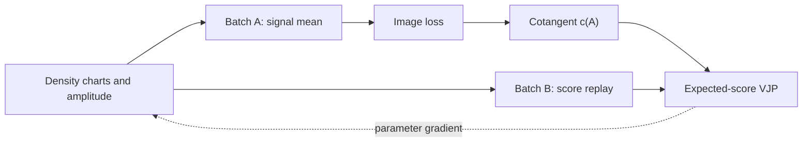
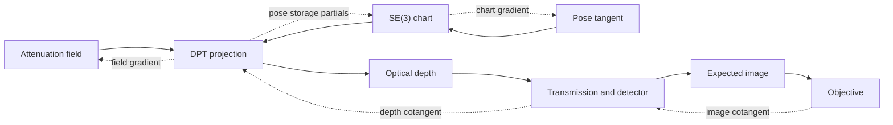

# Imaging and transport with Torch

`dpt.torch` connects DPT's projection and detector operators to Torch autograd. The expected-transport adapter adds Monte Carlo signal estimates and score gradients. Prepare the physical model and native workspaces, pass Torch tensors through the forward calculation and call `backward()` on the loss. Torch owns the returned images and gradients.

Use a CUDA-enabled Torch installation and DPT's [Torch dependencies](../getting-started/install.md). The [execution guide](../concepts/execution.md) explains workspace preparation and device ownership.

## Differentiate a projected image

This complete example projects an attenuation field, converts optical depth into expected primary counts and fits those counts with a Poisson objective. The attenuation field is in mm⁻¹. Grid spacing, detector coordinates and pose translations are in mm.

```python
import torch

from dpt.geometry import DetectorGeometry, RigidTransform
from dpt.objectives import ObjectiveSpec, prepare_objective
from dpt.projection import ProjectionSpec, prepare_projection
from dpt.torch import compose_pose, objective, project_optical_depth, transmit
from dpt.transmission import TransmissionSpec, prepare_transmission
from dpt.volumes import GridSpec

device = "cuda:0"
grid = GridSpec((3, 3, 4), (0.7, 0.8, 0.9), (-1.0, -1.0, -1.0))
detector = DetectorGeometry(
    (-8.0, 0.1, -0.2), (8.0, -0.3, -0.4),
    (0.0, 1.0, 0.0), (0.0, 0.0, 1.0), (0.2, 0.2), (2, 3),
)
projection = prepare_projection(
    grid, detector,
    ProjectionSpec(
        47, integration="cell_gauss", precision="float32",
        active_volume=True, active_pose=True,
    ),
    device=device,
)
transmission = prepare_transmission(
    TransmissionSpec(beam="device-scalar"),
    max_pixels=detector.pixels, device=device,
)
fidelity = prepare_objective(
    ObjectiveSpec(kind="poisson", domain="counts", precision="float32"),
    max_pixels=detector.pixels, device=device,
)

field = torch.linspace(0.1, 0.3, grid.voxels, dtype=torch.float32, device=device)
field = field.reshape(grid.shape).requires_grad_()
anchor = torch.tensor(RigidTransform().packed(), dtype=torch.float64, device=device)
tangent = torch.nn.Parameter(torch.zeros(6, dtype=torch.float64, device=device))
open_beam = torch.tensor([1000.0], dtype=torch.float32, device=device)

pose = compose_pose(anchor, tangent)
depth = project_optical_depth(field, pose, workspace=projection)
counts = transmit(depth, open_beam, output="counts", workspace=transmission)
observation = torch.full_like(counts, 500.0)
loss = objective(counts, observation, workspace=fidelity)
loss.backward()

assert counts.shape == (2, 3)
assert loss.dtype == torch.float64
assert torch.isfinite(field.grad).all().item()
assert torch.isfinite(tangent.grad).all().item()
print(float(loss.detach().cpu()))
```

The open-beam tensor supplies expected counts per pixel before attenuation. The observation supplies fixed integer counts. The defining primary model is

```text
L[p] = integral_ray mu(x) ds
expected_counts[p] = open_beam[p] * exp(-L[p])
```

`TransmissionSpec(beam="device-scalar")` broadcasts one resident beam value across the image. Choose `beam="per-pixel"` for a calibrated beam image, and `active_beam=True` when fitting that input. Projection's `active_volume` and `active_pose` flags similarly declare the derivatives its prepared workspace must support.

The final `.cpu()` is an explicit loss readback for display. Images and gradients can stay on the device for the optimiser.

## Fit a rigid pose

`compose_pose(anchor, tangent)` constructs the local-right rigid transform

```text
T(tangent) = T_anchor @ exp(hat(tangent))
tangent = (tx, ty, tz, rx, ry, rz)
```

Both arguments use FP64. The anchor stores twelve values: a row-major 3×3 rotation followed by its translation. Translations in the tangent are in mm and rotations are in radians. At a non-zero rotation, the SE(3) exponential also couples the translation to the rotation through its left Jacobian.

Keep the anchor fixed and optimise the six-coordinate tangent to retain a rigid pose. The projection adapter returns twelve storage partials internally, and Torch applies the chart's chain rule to obtain the tangent gradient. Leading dimensions of `compose_pose` follow Torch broadcasting.

## Project batches and views

The `Projector` module prepares one batched acquisition and returns `(views, rows, columns)` from a single field. See [differentiate projections](../pytorch.md) for the real CT example. Use a `(views, 6)` FP64 `pose` tensor for independent view motion, or `(6,)` to share one rigid increment. Explicitly stack separate module calls when the application needs a batch of different volumes.

## Differentiate a spectral image

`project_spectral_signal` combines dimensionless material fields with energy-dependent attenuation, photon populations and detector response. Select the inputs to fit through their `requires_grad` settings and the corresponding prepared activity flags:

| Input | Shape and storage | Units | Activity flag |
|---|---|---|---|
| Material fields | `(M, nz, ny, nx)` or `(M, voxels)`, FP32 | Dimensionless | `ProjectionSpec.active_volume` |
| Packed pose | `(12,)`, FP64 | Rotation entries dimensionless, translation in mm | `ProjectionSpec.active_pose` |
| Coefficients | `(M, K)`, FP32 | mm⁻¹ | `SpectralSpec.active_coefficients` |
| Population weights | `(K,)` or `(K, P)`, FP32 | Photons integrated over each energy bin | `SpectralSpec.active_weights` |
| Response | `(K,)` or `(K, P)`, FP32 | Declared response per photon | `SpectralSpec.active_response` |

Here `M` is the material count, `K` the energy-bin count and `P` the detector pixel count. Shared weights and response use `(K,)`. Set `shared_weights=False` or `shared_response=False` for their energy-major `(K, P)` layouts. Contiguous flat coefficient and factor views retain that element order. All tensors reside on the prepared device, and both native workspaces use one owning stream.

Material fields integrate to paths in mm. The discrete spectral mean is

```text
A[m,p] = integral_ray f[m](x) ds
I[p] = sum_k weights[k,p] * response[k,p]
             * exp(-sum_m coefficients[m,k] * A[m,p])
```

The mean's unit follows the response: a detection probability gives expected counts, while energy deposited per photon gives expected deposited energy. Population weights already include energy-bin integration. The [spectral guide](spectral-detector.md) explains how to convert a density spectrum into those populations.

Field or pose derivatives pass through material paths, so prepare `active_paths=True` and a matching material path-cotangent buffer. Factor-only fitting can use fixed paths. Projection and spectral precision must agree. `output_domain="log"` selects the natural logarithm of the mean and its matching derivative.

Continuing the grid, detector and anchor setup above, this example differentiates all five input groups. The pose chart exposes six rigid-motion parameters while its packed intermediate retains the twelve native storage partials:

```python
import warp as wp

from dpt.material_projection import prepare_material_projection
from dpt.spectral import SpectralSpec, prepare_spectral
from dpt.torch import project_spectral_signal

materials, energies = 2, 3
material_fields = torch.linspace(
    0.06, 0.2, materials * grid.voxels, dtype=torch.float32, device=device
).reshape(materials, *grid.shape).requires_grad_()
spectral_tangent = torch.nn.Parameter(
    torch.tensor([0.03, -0.02, 0.01, 0.04, -0.03, 0.02], dtype=torch.float64, device=device)
)
spectral_pose = compose_pose(anchor, spectral_tangent)
spectral_pose.retain_grad()
coefficients = torch.nn.Parameter(
    torch.tensor([[0.2, 0.4, 0.6], [0.6, 0.5, 0.3]], dtype=torch.float32, device=device)
)
populations = torch.nn.Parameter(
    torch.tensor([20.0, 30.0, 10.0], dtype=torch.float32, device=device)
)
response = torch.nn.Parameter(
    torch.tensor([0.8, 0.5, 0.9], dtype=torch.float32, device=device)
)
material_workspace = prepare_material_projection(
    grid, detector,
    ProjectionSpec(
        47, integration="cell_gauss", precision="float64",
        active_volume=True, active_pose=True,
    ),
    materials=materials,
    fields=wp.from_torch(material_fields.reshape(-1), requires_grad=False),
    out_paths=wp.empty(materials * detector.pixels, dtype=wp.float64, device=device),
    cotangent_paths=wp.empty(materials * detector.pixels, dtype=wp.float64, device=device),
    device=device,
)
spectral_workspace = prepare_spectral(
    SpectralSpec(
        materials, energies, precision="float64", active_paths=True,
        active_coefficients=True, active_weights=True, active_response=True,
        output_unit="expected counts",
    ),
    max_pixels=detector.pixels, device=device, stream=material_workspace.context.stream,
)
spectral_image = project_spectral_signal(
    material_fields, spectral_pose, coefficients, populations, response,
    material_workspace=material_workspace, spectral_workspace=spectral_workspace,
)
spectral_image.sum().backward()
assert spectral_image.shape == detector.shape
assert spectral_pose.grad.shape == (12,)
assert spectral_tangent.grad.shape == (6,)
for value in (material_fields, coefficients, populations, response, spectral_tangent):
    assert value.grad.shape == value.shape
    assert torch.isfinite(value.grad).all().item()
```

Torch returns each gradient in the input tensor's shape and dtype. The coefficient, population and response tensors therefore have FP32 gradients even with FP64 paths and images. Shared factors accumulate contributions across pixels. Keep fitted populations, coefficients and response within their physical domains, and use a rigid chart for pose updates.

Wrap `project_spectral_signal` in a Torch module when the application needs registered material or calibration parameters. Stack separate calls explicitly for a batch of material volumes.

## Differentiate an expected transport signal

A Monte Carlo transport image depends on the histories drawn from the model. A density change alters both the detector contribution and the probability of drawing a history. The expected-transport adapter accounts for those terms with the native likelihood/direct-weight score. Prepare a forward batch `A` and an independent derivative batch `B`. Autograd returns the expected-signal Jacobian estimate contracted with the loss's image cotangent:

```text
image = mu_hat_A
c(A) = grad L(mu_hat_A)
parameter gradient = J_hat_B.T @ c(A)
```

The two batches have separate jobs. Batch `A` supplies the image used by the loss, while batch `B` supplies the score derivative of the expected image. Conditional on `c(A)`, the score replay estimates `J.T @ c(A)`. For squared error, `c(A) = mu_hat_A - observation`, so averaging independent batches gives the expected-image loss gradient. For a nonlinear cotangent, such as a reciprocal, account for the difference between `E[c(mu_hat_A)]` and `c(mu)`: select an estimator for that objective or control the image's sampling error. Book [§10.9](https://photontransport.com/chapters/differentiating-transport/#109-inverse-problems-with-stochastic-gradients) derives the independent squared-error construction.

This complete example sends a pencil beam through four absorption layers. Each layer is 0.6 mm thick. Material and voxel multipliers are fitted in log coordinates, which keep their exponentiated values positive. The source amplitude is a direct measurement multiplier.

```python
import torch
import warp as wp

from dpt.interop.torch_transport import (
    ExpectedTransportEstimator,
    TransportAutogradSpec,
    estimate_expected_transport,
    prepare_expected_transport,
)
from dpt.transport.forward import prepare_transport
from dpt.transport.model import MaterialGrid, PlanarDetector, TransportSpec
from dpt.transport.rng import HistoryBatch
from dpt.transport.source import ParallelBeam

wp.init()
device = "cuda:0"
transport_grid = MaterialGrid(
    (-1.0, -1.0, 0.0), (2.0, 2.0, 0.6), (4, 1, 1), 2,
)
transport_spec = TransportSpec(
    transport_grid,
    PlanarDetector((-1.0, -1.0), (2.0, 2.0), (1, 1), 3.4),
    80.0,
    "four absorption layers",
    estimator="continuous-absorption",
    scoring="photon-count",
)
native_transport = prepare_transport(
    transport_spec,
    material_ids=wp.array([0, 1, 0, 1], dtype=wp.int32, device=device),
    absorption=wp.array([0.13, 0.17], dtype=wp.float64, device=device),
    scattering=wp.zeros(2, dtype=wp.float64, device=device),
    max_histories=8192,
    device=device,
)
source = ParallelBeam((0.0, 0.0, -1.0), (0.0, 0.0), weight=1.3)
transport_workspace = prepare_expected_transport(
    native_transport,
    source=source,
    parameters=TransportAutogradSpec(),
    slots_per_history=8,
    max_snapshot_bytes=256 * 1024 * 1024,
)
log_voxel_density = torch.nn.Parameter(
    torch.tensor([0.8, 0.97, 1.14, 1.31], dtype=torch.float64, device=device)
    .log().reshape(transport_grid.shape)
)
log_material_density = torch.nn.Parameter(
    torch.tensor([1.1, 1.18], dtype=torch.float64, device=device).log()
)
source_amplitude = torch.nn.Parameter(
    torch.tensor(0.7, dtype=torch.float64, device=device)
)
transport_estimator = ExpectedTransportEstimator(
    HistoryBatch(7315, 0, 11),
    HistoryBatch(8427, 0, 17),
    cotangent_origin="forward-batch",
)
estimate = estimate_expected_transport(
    log_voxel_density, log_material_density, source_amplitude,
    workspace=transport_workspace, estimator=transport_estimator,
)
transport_observation = torch.full_like(estimate.signal, 0.4)
transport_loss = 0.5 * (estimate.signal - transport_observation).square().sum()
transport_loss.backward()

assert estimate.signal.shape == (1, 1)
for value in (log_voxel_density, log_material_density, source_amplitude):
    assert value.grad.shape == value.shape
    assert value.grad.dtype == torch.float64
    assert torch.isfinite(value.grad).all().item()

# Independent absorption formula for this layered pencil-beam geometry.
with torch.no_grad():
    voxel_multiplier = log_voxel_density.exp().reshape(-1)
    material_multiplier = log_material_density.exp()
    labels = torch.tensor([0, 1, 0, 1], dtype=torch.long, device=device)
    coefficients = torch.tensor(
        [0.13, 0.17, 0.13, 0.17], dtype=torch.float64, device=device,
    )
    optical_depth = (
        0.6 * coefficients * material_multiplier[labels] * voxel_multiplier
    ).sum()
    unit_response = source.weight * torch.exp(-optical_depth)
    expected_signal = source_amplitude * unit_response
    torch.testing.assert_close(
        estimate.signal, expected_signal.reshape(1, 1), rtol=1e-12, atol=1e-12,
    )
    torch.testing.assert_close(
        source_amplitude.grad, (expected_signal - 0.4) * unit_response,
        rtol=1e-12, atol=1e-12,
    )
```

The coefficient tables contain linear partial attenuation in mm⁻¹. Their effective value in voxel `v` is multiplied by `exp(log_material_density[material_id[v]]) * exp(log_voxel_density[v])`. The image is the weighted detector score per launched original history. Forward normalises by `A.count` and backward by `B.count`, including misses. Increasing either history count improves numerical precision while leaving the physical source multiplier unchanged.

`ParallelBeam` can sample a rectangle, and `PointConeSource` samples its declared panel. The adapter attaches the sampler identity to each batch, then checks both transport and source-draw addresses for independence. Declare an external stochastic cotangent with `cotangent_origin="external-batch"` and its `external_cotangent_batch`. Use `cotangent_origin="deterministic"` for a fixed image cotangent:

```python
from dpt.interop.torch_transport import expected_transport_signal

fixed_cotangent_estimator = ExpectedTransportEstimator(
    HistoryBatch(7315, 11, 11), HistoryBatch(8427, 17, 17),
    cotangent_origin="deterministic",
)
signal = expected_transport_signal(
    log_voxel_density, log_material_density, source_amplitude,
    workspace=transport_workspace, estimator=fixed_cotangent_estimator,
)
fixed_cotangent = torch.full_like(signal, -0.3)
transport_gradients = torch.autograd.grad(
    signal, (log_voxel_density, log_material_density, source_amplitude),
    grad_outputs=fixed_cotangent,
)
assert all(torch.isfinite(value).all().item() for value in transport_gradients)
```

### Select parameters and retain their values

`TransportAutogradSpec(active_voxels=(0, 2), active_materials=(1,), active_source_amplitude=False)` selects two voxel entries and one material scale. `None` selects every entry, and `()` fixes the entire voxel or material chart. Fixed coordinates remain model inputs. Give them `requires_grad=False`. Unselected entries in an active tensor receive zero gradients. Every coordinate tensor uses contiguous FP64 storage on the prepared native device. Exponentiated densities must remain finite and positive, and source amplitude must remain finite and nonnegative. Its derivative at zero is the unit-amplitude response.

Use `ExpectedTransport` to retain the coordinates as a module. Supplied Parameters stay registered and each forward uses their current values. Continuing the example, this takes one optimiser step with new batch addresses:

```python
from dpt.interop.torch_transport import ExpectedTransport

transport_module = ExpectedTransport(
    log_voxel_density, log_material_density, source_amplitude,
    workspace=transport_workspace, estimator=transport_estimator,
)
assert transport_module.log_voxel_density is log_voxel_density
transport_optimiser = torch.optim.SGD(transport_module.parameters(), lr=0.02)
transport_optimiser.zero_grad()
fresh_estimator = ExpectedTransportEstimator(
    HistoryBatch(7315, 22, 11), HistoryBatch(8427, 34, 17),
)
fresh_estimate = transport_module(estimator=fresh_estimator)
fresh_loss = 0.5 * (fresh_estimate.signal - transport_observation).square().sum()
fresh_loss.backward()
transport_optimiser.step()
```

For each outstanding forward, the adapter retains an owned density/amplitude snapshot, separate source states and native score scratch. Complete all backwards involving a parameter before updating it. Torch's version counters also protect saved fixed inputs. Use `torch.no_grad()` for signal-only evaluation, and first-order settings for `backward()` or `torch.autograd.grad`.

Choose `slots_per_history` to hold the distinct selected voxels visited by one history. The complete snapshot must fit `max_snapshot_bytes`, including all material/source groups. An exhausted crossing, interaction or sparse-storage budget raises `IncompleteHistoryError`. Discard that estimate and increase the appropriate budget before evaluating again. Native status checks complete on the owning stream, and the event bridge orders that work with the calling Torch stream.



Read the [expected-transport API](../reference/api-torch.md#expected-transport-and-score-gradients) for shapes, selected charts and cotangent identities. Book [§10.3](https://photontransport.com/chapters/differentiating-transport/#103-differentiate-the-sampling-law) derives the score contributions, and [§10.7](https://photontransport.com/chapters/differentiating-transport/#107-independent-gradient-validation) develops independent gradient checks.

## Compose detector operators

The Torch functions use the same physical specifications as the native operators:

| Function | Forward calculation | Autograd inputs |
|---|---|---|
| `transmit` | `exp(-L)`, `-L`, `-expm1(-L)` or expected counts | Active optical depth and declared active beam |
| `affine_calibrate` | `gain * exposure * mean + offset` | Mean and declared active shared calibration scalars |
| `blur` | Supplied fixed PSF with zero extension outside the panel | Signal |
| `objective` | Squared error or Poisson half-deviance, returned as an FP64 scalar | Prediction |
| `project_spectral_signal` | Material paths followed by the supplied spectral sum | Declared active fields, packed pose, coefficients, populations and response |

Transmission, calibration and blur use contiguous FP32 tensors. Projection uses a contiguous FP32 field and FP64 pose, with output precision selected by `ProjectionSpec`. An objective accepts prediction precision selected by `ObjectiveSpec`. Observations and weights are fixed FP32 tensors and validity masks are fixed `uint8` tensors with the same image shape. Mean reduction divides by the full pixel count.

Calibration distinguishes shared scalars from fixed pixel arrays. Choose either gain or exposure as the active acquisition scale: their product alone cannot identify both. Blur's backward applies the exact transpose of its zero-extended stencil, including the panel boundary.

Use `requires_grad=False` for fixed acquisition factors and enable the corresponding activity flag for each fitted tensor. The [spectral example](#differentiate-a-spectral-image) shows the complete material-path chain.



## Retain tensors through backward

Returned tensors own their storage, so another forward evaluation can run while the earlier image remains available. Each autograd node retains the inputs needed by its reverse calculation. For a spectral image, backward recomputes paths and spectral derivatives from that node's five saved tensors, allowing outstanding forwards with different fields or factors to share scratch sequentially. Expected transport retains a separate model/source snapshot and derivative scratch for each node. Keep saved tensors unchanged until their backward completes. Torch's version counters detect in-place changes, including to fixed factors.

On CUDA, the adapter orders the calling stream and the workspace's owning stream with events, and records tensor use with the Torch allocator. Follow Torch's producer-stream rules when an input was created on another stream. The adapter then orders its native work before subsequent operations on the calling stream. Checked native calls retain their completion checks on the owning stream.

Workspaces are used sequentially. Allocate distinct workspaces for overlapping calculations. These native autograd adapters compute first-order derivatives. Use `backward()` or `torch.autograd.grad` with the first-order settings. For `validate=False`, complete the workspace's diagnostic check before accepting the result, as described in [execution and ownership](../concepts/execution.md#check-numerical-completion).
