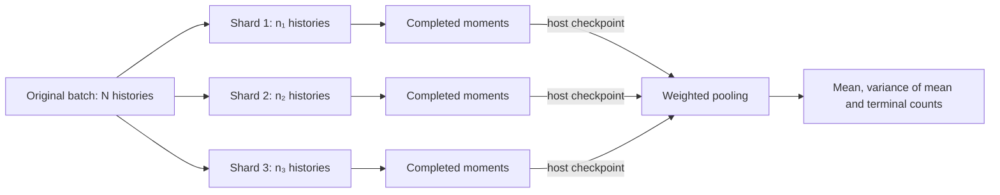

# Partition and replay photon histories

A transport batch identifies original photon histories by their seed and counter range. Partitioning that range lets you process a large calculation in smaller pieces while preserving each history's random draws. A prepared transport graph serves a different purpose: it replays one fixed batch through resident buffers while you change the material-density multipliers.

Both operations retain the original-history denominator. A photon that misses the detector or is absorbed contributes zero to the image and still counts as a launched history. Read [the simulation guide](simulation.md) for the mean, variance and terminal-status outputs.

## Partition a batch

`HistoryBatch.shard(parts, rank)` returns an immutable `HistoryShard`. Its `.batch` is the counter range to pass to transport, `.offset` locates that range within the original batch, and `.original_count` retains the complete launched-history count.

```python
from dpt.transport import HistoryBatch

batch = HistoryBatch(seed=92761, first_history=1000, count=10)
shards = tuple(batch.shard(3, rank) for rank in range(3))
assert tuple(shard.batch.count for shard in shards) == (4, 3, 3)
assert tuple(shard.batch.first_history for shard in shards) == (1000, 1004, 1007)
assert all(shard.original_count == 10 for shard in shards)

nested = shards[0].shard(2, 1)
assert nested.batch.first_history == 1002
assert nested.offset == 2
assert nested.original_count == 10
```

Partitions are balanced and non-empty. Nested partitions retain their complete lineage and original counter addresses. The sampler identity and source namespace follow the history range, so processing the same history in a different piece retains its random draws.

## Combine completed estimates

Each shard computes a mean using its own launched-history count. Pool the completed estimates with those counts as weights. If shard `s` has count `n_s`, mean `m_s` and centred sum of squares `M2_s`, then

```text
N = sum_s n_s
mean = sum_s n_s * m_s / N
M2 = sum_s (M2_s + n_s * (m_s - mean)**2)
estimated_variance_of_mean = M2 / (N * (N - 1))
```

The between-shard term matters even when all shards have the same size. Averaging their variance images alone loses it.

`ShardMoments` stores an immutable host checkpoint. Supply either the raw centred sum of squares or the estimated variance of the shard mean. For example, scores `(0, 1, 2)` and `(3, 5)` give the following two checkpoints:

```python
import math

from dpt.transport import HistoryBatch, ShardMoments, pool_shard_moments

batch = HistoryBatch(seed=52, first_history=0, count=5)
left, right = (batch.shard(2, rank) for rank in range(2))
records = (
    ShardMoments(
        left, (1.0,), "one-pixel analytic score example",
        centred_sum_squares=(2.0,), status_counts=(3, 0, 0, 0, 0, 0, 0),
    ),
    ShardMoments(
        right, (4.0,), "one-pixel analytic score example",
        centred_sum_squares=(2.0,), status_counts=(2, 0, 0, 0, 0, 0, 0),
    ),
)
pooled = pool_shard_moments(records)
assert math.isclose(pooled.mean[0], 2.2, rel_tol=1e-15)
assert math.isclose(pooled.estimated_variance_of_mean[0], 0.74, rel_tol=1e-15)
assert pooled.status_counts == (5, 0, 0, 0, 0, 0, 0)
```

The seven status counts account for every history and accept completed escape/absorption outcomes. Pooling checks that the records cover the original range exactly once, without gaps or overlaps. The records must share the physical configuration, source law, scoring convention and pixel/component layout. Use a configuration identity derived from those fixed inputs. A generic stochastic source also supplies `iid_source_provenance`. Library samplers carry their structural source identity with the batch.

A singleton shard supplies raw `centred_sum_squares=(0.0, ...)`. Its own variance estimate is unavailable, while the completed pool can estimate variance once the total count is at least two. These are marginal pixel variances. Use independent complete-batch replicates to estimate uncertainty in a sum across pixels or a nonlinear objective.

## Run sequential simulation shards

This complete CUDA example processes an absorption-only slab in three unequal pieces. The coefficients are in mm⁻¹, the density multiplier is dimensionless and continuous absorption gives the analytic score `exp(-0.3)` for every axial history.

```python
import math

import warp as wp

from dpt.transport import (
    HistoryBatch, ParallelBeam, ShardMoments, pool_shard_moments,
    prepare_simulation, simulate,
)
from dpt.transport.forward import prepare_transport
from dpt.transport.model import MaterialGrid, PlanarDetector, TransportSpec

device, count = "cuda:0", 10
spec = TransportSpec(
    grid=MaterialGrid((-1.0, -1.0, 0.0), (2.0, 2.0, 1.0), (1, 1, 1), 1),
    detector=PlanarDetector((-1.0, -1.0), (2.0, 2.0), (1, 1), 2.0),
    energy_kev=80.0,
    coefficient_provenance="analytic slab, absorption=0.3/mm, scattering=0/mm",
    estimator="continuous-absorption",
)
transport = prepare_transport(
    spec,
    material_ids=wp.array([0], dtype=wp.int32, device=device),
    absorption=wp.array([0.3], dtype=wp.float64, device=device),
    scattering=wp.array([0.0], dtype=wp.float64, device=device),
    max_histories=count, device=device,
)
workspace = prepare_simulation(transport, max_histories=count)
density = wp.array([1.0], dtype=wp.float64, device=device)
source = ParallelBeam((0.0, 0.0, -1.0), (0.0, 0.0))
original = HistoryBatch(92761, 0, count).with_library_source("parallel-rectangle-v1")
records = []
for rank in range(3):
    shard = original.shard(3, rank)
    result = simulate(density, source=source, batch=shard.batch, workspace=workspace)
    records.append(
        ShardMoments(
            shard,
            tuple(float(value) for value in result.mean.numpy()),
            "1mm slab, mu_a=0.3/mm, density=1, axial unit source, one count pixel",
            estimated_variance_of_mean=tuple(
                float(value) for value in result.estimated_variance_of_mean.numpy()
            ),
            status_counts=result.status_histogram.counts,
        )
    )
pooled = pool_shard_moments(records)
assert math.isclose(pooled.mean[0], math.exp(-0.3), rel_tol=1e-12)
assert pooled.estimated_variance_of_mean[0] < 1e-28
assert sum(pooled.status_counts) == count
```

The `.numpy()` calls explicitly transfer the two estimate images into each checkpoint before the workspace is reused. `pool_shard_moments` combines those host records. It performs neither device launches nor transfers. Use the default plain tally initially, then compare grouped tallying on your actual panel and history distribution.



## Replay a fixed batch on CUDA

`prepare_transport_graph` warms and captures source sampling, history tracing, moment tallying and the terminal histogram. It binds a resident FP64 density array of shape `(materials,)`. Update that array's values on the owning stream to compare material-density multipliers with common random numbers.

This complete example retains the first image before replaying the same histories at density 1.2:

```python
import math

import warp as wp

from dpt.transport import HistoryBatch, ParallelBeam, prepare_simulation, prepare_transport_graph
from dpt.transport.forward import prepare_transport
from dpt.transport.model import MaterialGrid, PlanarDetector, TransportSpec

device, count = "cuda:0", 128
stream = wp.Stream(device=device)
spec = TransportSpec(
    grid=MaterialGrid((-1.0, -1.0, 0.0), (2.0, 2.0, 1.0), (1, 1, 1), 1),
    detector=PlanarDetector((-1.0, -1.0), (2.0, 2.0), (1, 1), 2.0),
    energy_kev=80.0,
    coefficient_provenance="analytic slab, absorption=0.3/mm, scattering=0/mm",
    estimator="continuous-absorption",
)
with wp.ScopedStream(stream):
    transport = prepare_transport(
        spec,
        material_ids=wp.array([0], dtype=wp.int32, device=device),
        absorption=wp.array([0.3], dtype=wp.float64, device=device),
        scattering=wp.array([0.0], dtype=wp.float64, device=device),
        max_histories=count, device=device, stream=stream,
    )
    density = wp.array([1.0], dtype=wp.float64, device=device)
workspace = prepare_simulation(transport, max_histories=count)
graph = prepare_transport_graph(
    density,
    source=ParallelBeam((0.0, 0.0, -1.0), (0.0, 0.0)),
    batch=HistoryBatch(92761, 0, count), workspace=workspace, stream=stream,
)
first = graph.replay(stream=stream)
with wp.ScopedStream(stream):
    retained_mean = wp.clone(first.mean)
    density.fill_(1.2)
changed = graph.replay(stream=stream)
assert math.isclose(float(retained_mean.numpy()[0]), math.exp(-0.3), rel_tol=1e-12)
assert math.isclose(float(changed.mean.numpy()[0]), math.exp(-0.36), rel_tol=1e-12)
assert first.batch == changed.batch
assert changed.status_histogram.total == count
```

The graph fixes source, source amplitude, material tables, geometry, batch identity, launch dimensions and buffer bindings. Its preparation runs one checked simulation and overwrites the workspace images. Each replay checks the mutable density and numerical completion outside capture, then returns resident mean and variance images with a host terminal histogram.

Result images alias the simulation workspace. Copy an image before another replay when you need to retain it. Keep the workspace and bound model arrays alive, use its owning stream and prepare a new graph when fixed metadata or buffer bindings change.

Replaying unchanged inputs reproduces the same sample. Use disjoint complete batches for independent replicates and a fixed batch for coupled parameter comparisons. Supported likelihood-ratio derivatives can reuse that batch through [the derivative-history interface](transport.md#estimate-a-density-derivative). The graph captures the forward estimate and moments.
