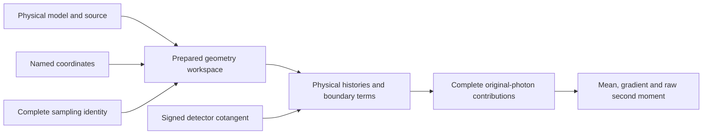

# Differentiate transport geometry

Moving a material face or detector edge changes which photon histories contribute
to an image. Differentiating the path lengths alone misses that change.
`prepare_transport_geometry` prepares the physical model and its boundary terms.
`transport_geometry_vjp` contracts the resulting expected-image derivative with
your detector cotangent.

Use this interface for object, source, launch-target and detector geometry. It
supports absorption, isotropic elastic scattering, free and bound Compton
scattering, Rayleigh scattering, fluorescence and fixed source spectra. The
atomic tables, coefficients and source probabilities stay fixed during a geometry
pullback. Use the [coefficient and source-logit interfaces](transport-readout.md)
to differentiate those quantities.

## Select physical coordinates

`GeometryParameter(component, coordinate, axis, pivot_mm=...)` names each active
coordinate. Returned gradients follow the order you supply.

| Component | Coordinates |
|---|---|
| `object` | `translation`, `rotation`, `grid-origin`, `grid-spacing` |
| `source` | `translation`, `rotation`, `extent`, `beam-direction` |
| `launch-target` | `translation`, `rotation`, `pixel-spacing` |
| `detector` | `translation`, `rotation`, `pixel-spacing` |

Cartesian axes are numbered x=0, y=1, z=2. Source extents and detector spacings
have two axes in their existing column/row order. Translation, origin, spacing
and extent derivatives are per mm. Rotation derivatives are per radian about
`pivot_mm`. A point source has no rectangular extent or beam-direction
coordinate: select its position or its cone's launch target instead.

`GeometryPhysicalMedium` contains immutable host tuples: material labels and
voxel densities per cell, positive density scales per material, and
material-major, energy-fastest absorption/scattering coefficients in mm⁻¹.
Supply its `physical` record for atomic interactions or a source spectrum.
Preparation checks the complete model and uploads it once to the selected device.

## Differentiate an absorbing slab

Install `.[warp]`, save this example as `slab_geometry.py`, and run
`python slab_geometry.py`. The slab is 1 mm thick with attenuation 0.7 mm⁻¹. A
detector cotangent of −2 gives the contracted mean `-2 * exp(-0.7)`.

```python
import math

import numpy as np
import warp as wp

from dpt.transport import (
    GeometryParameter, GeometryPhysicalMedium, GeometrySamplingDesign,
    HistoryBatch, MaterialGrid, ParallelBeam, PlanarDetector, TransportSpec,
    prepare_transport_geometry, transport_geometry_vjp,
)

device, count = "cpu", 4096
spec = TransportSpec(
    MaterialGrid((0.0, 0.0, 0.0), (1.0, 1.0, 1.0), (1, 1, 1), 1),
    PlanarDetector((-5.0, -5.0), (10.0, 10.0), (1, 1), 3.0),
    80.0, "Synthetic 0.7/mm absorption slab", max_events=4, max_angle_trials=2,
)
workspace = prepare_transport_geometry(
    spec,
    source=ParallelBeam((0.4, 0.45, -1.0), (0.0, 0.0)),
    medium=GeometryPhysicalMedium((0,), (0.7,), (0.0,), (1.0,), (1.0,)),
    parameters=(GeometryParameter("object", "grid-spacing", 2),),
    batch=HistoryBatch(19, 0, count),
    design=GeometrySamplingDesign("iid", 4, 2, 2),
    device=device,
)
cotangent = wp.array([-2.0], dtype=wp.float64, device=device)
outputs = {
    name: wp.empty((count, 1), dtype=wp.float64, device=device)
    for name in ("out_values", "out_derivatives")
}
outputs["out_counts"] = wp.empty((count, 1), dtype=wp.vec2i, device=device)
outputs.update({
    name: wp.empty(1, dtype=wp.float64, device=device)
    for name in ("out_mean", "out_gradient", "out_second_moment")
})
transport_geometry_vjp(cotangent, workspace=workspace, **outputs)
np.testing.assert_allclose(outputs["out_mean"].numpy(), -2.0 * math.exp(-0.7))
print("contracted mean:", outputs["out_mean"].numpy())
gradient = float(outputs["out_gradient"].numpy()[0])
second_moment = float(outputs["out_second_moment"].numpy()[0])
standard_error = math.sqrt(max(0.0, (second_moment - gradient**2) / (count - 1)))
print("thickness gradient:", gradient, "standard error:", standard_error)
```

The selected grid-spacing coordinate changes the slab thickness. Its expected
gradient is `1.4 * exp(-0.7)` per mm. Compare the estimate with this value using
the printed IID standard error. Retain the original-photon contributions when
studying sampling error.

For CUDA, set `device="cuda:0"` in both preparation and array allocation. Calls
reuse the prepared device and stream and allocate no device arrays.

## Allocate outputs and retain the sampling identity

For `N` original photons and `P` coordinates:

| Buffer | Warp dtype | Shape |
|---|---|---|
| Detector cotangent | `float64` | `(detector.pixels,)` |
| `out_values`, `out_derivatives` | `float64` | `(N, P)` |
| `out_counts` | `vec2i` | `(N, P)` |
| `out_mean`, `out_gradient`, `out_second_moment` | `float64` | `(P,)` |

Each original-photon contribution includes its correlated physical continuation
and material, source and detector boundary terms. Reduction computes the mean
gradient and raw second moment after combining those terms. For IID observations,
the estimated variance of the mean is `(second_moment - gradient**2)/(N - 1)`.
For stratified or scrambled Sobol sampling, estimate uncertainty across
independent complete designs instead.



`GeometrySamplingDesign` supports IID, stratified and scrambled Sobol laws.
Select the physical layout matching the model, including `bound-compton-v3` for
shell/Doppler histories. Its complete identity reserves both physical continuation
and geometry auxiliary coordinates. Use `design.dimensions` to check the total.
Randomised designs are limited to 21,201 coordinates. The event guard and reserved
counter span are separate quantities.

## Respect the prepared geometry chart

Preparation checks the active material planes, source support and detector
boundaries. An active coincidence or other undefined chart raises
`TransportError`. Choose a regular configuration before requesting a derivative.
Keep the model immutable for the workspace lifetime and prepare a new workspace
after changing it.

Output buffers must be mutually disjoint and separate from the cotangent and all
prepared buffers. Checked calls verify sticky status before and after execution.
With `validate=False`, call `workspace.check_status()` before using the outputs.
Guard exhaustion or a failed continuation invalidates the complete original
observation and every reduction. Discard failed outputs before clearing status
at a new run boundary.
