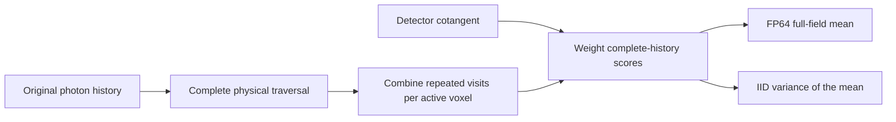

# Photon histories

Transport estimates a detector expectation from original photon histories. A history can miss the detector, be absorbed or arrive after scattering. All of these outcomes belong in the denominator. Conditioning the estimate on detected photons would answer a different question.

The transport API uses Warp on an explicit CPU or CUDA device and a piecewise-constant material grid. Read [the geometry comparison](../concepts/geometry.md) before translating deterministic projection fixtures into transport inputs.

## An absorption-only slab

This example uses an analytic fixture: a 1 mm slab with absorption 0.3 mm⁻¹ and no scattering. Continuous absorption retains the attenuation in the weight, so all identical axial histories have score `exp(-0.3)`.

The following complete program traces 512 histories and computes the mean:

```python
import math

import warp as wp

from dpt.transport.estimators import history_mean, prepare_estimators
from dpt.transport.forward import prepare_transport, trace_histories
from dpt.transport.model import MaterialGrid, PlanarDetector, TransportSpec
from dpt.transport.rng import HistoryBatch

device, count = "cuda:0", 512
spec = TransportSpec(
    grid=MaterialGrid((-1.0, -1.0, 0.0), (2.0, 2.0, 1.0), (1, 1, 1), 1),
    detector=PlanarDetector((-1.0, -1.0), (2.0, 2.0), (1, 1), 2.0),
    energy_kev=80.0,
    coefficient_provenance="analytic 1 mm absorption slab, mu_a=0.3/mm",
    estimator="continuous-absorption",
)
workspace = prepare_transport(
    spec,
    material_ids=wp.array([0], dtype=wp.int32, device=device),
    absorption=wp.array([0.3], dtype=wp.float64, device=device),
    scattering=wp.array([0.0], dtype=wp.float64, device=device),
    max_histories=count, device=device,
)
positions = wp.array([(0.0, 0.0, -1.0)] * count, dtype=wp.vec3d, device=device)
directions = wp.array([(0.0, 0.0, 1.0)] * count, dtype=wp.vec3d, device=device)
weights = wp.array([1.0] * count, dtype=wp.float64, device=device)
density = wp.array([1.0], dtype=wp.float64, device=device)
batch = HistoryBatch(seed=92761, first_history=0, count=count)
pixel = wp.empty(count, dtype=wp.int32, device=device)
score = wp.empty(count, dtype=wp.float64, device=device)
status = wp.empty(count, dtype=wp.int32, device=device)
energy = wp.empty(count, dtype=wp.float64, device=device)
events = wp.empty(count, dtype=wp.int32, device=device)
trace_histories(
    positions, directions, weights, density, batch=batch, workspace=workspace,
    out_pixel=pixel, out_score=score, out_energy=energy,
    out_events=events, out_status=status,
)
mean = wp.empty(1, dtype=wp.float64, device=device)
history_mean(
    pixel, score, status, batch=batch,
    workspace=prepare_estimators(workspace), out_mean=mean,
)
assert math.isclose(float(mean.numpy()[0]), math.exp(-0.3), rel_tol=1e-12)
```

The detector lies above the entire material grid. The source arrays contain explicit positions and unit directions, so no emission law is inferred.

## Estimate a density derivative

The active parameter below is the logarithm of the material-density multiplier. For this slab, the derivative of the mean at density one is `-0.3 * exp(-0.3)`.

```python
from dpt.transport.derivatives import TransportParameter, derivative_histories

derivative = wp.empty(count, dtype=wp.float64, device=device)
derivative_histories(
    positions, directions, weights, density,
    parameter=TransportParameter("log-material-density", 0),
    batch=batch, workspace=workspace, out_pixel=pixel,
    out_derivative=derivative, out_status=status,
)
history_mean(
    pixel, derivative, status, batch=batch,
    workspace=prepare_estimators(workspace), out_mean=mean,
)
assert math.isclose(float(mean.numpy()[0]), -0.3 * math.exp(-0.3), rel_tol=1e-12)
```

Reusing the batch supplies matching random paths for the derivative estimator. Nonlinear product factors require separate independent batches. Transport derivatives estimate derivatives of expected scores under the declared flight law, using likelihood terms and explicit weight derivatives.

## Reverse into a spatial density field

Use `voxel_density_vjp` to contract a detector cotangent with the derivative of the expected image with respect to every selected voxel's log-density. The material grid, source law, detector and conditional scattering law stay fixed. Each voxel multiplier scales its material's absorption and scattering coefficients together.

Write the dimensionless voxel multiplier as `theta[v]` and its active coordinate as `eta[v] = log(theta[v])`. Active multipliers must be finite and strictly positive. An inactive voxel can have multiplier zero: it is fixed vacuum. Supply the field as `voxel_density` when preparing transport and select active cells with a flat `int32` mask of zeros and ones. Omitting the mask selects every voxel. Omitting the field sets every multiplier to one. The positive material scales passed as `density` multiply this spatial field.

For a detected original history `i`, the contribution to voxel `v` is

\[
Z_{i,v}=c_{p_i}X_i\bigl(K_{i,v}-\tau_{i,v}\bigr),\qquad
\widehat g_v=\frac{1}{N}\sum_{i=1}^{N}Z_{i,v}.
\]

Here `c` is the detector cotangent, `X_i` is the complete detector score including source weight and amplitude, and `tau` is the voxel's total extinction depth along the complete realised path, including escape. Analogue sampling counts interactions in `K`. Continuous absorption counts scatterings and adds the explicit absorption-weight derivative through `tau`. Missed, absorbed and unvisited histories contribute zero. Every original history remains in `N`.

This complete example reverses through three axial cells, each 1 mm thick. The middle cell is fixed vacuum. With absorption 0.3 mm⁻¹, the two active cells have depths 0.15 and 0.45. A detector cotangent of two gives gradients `-2 * depth[v] * exp(-0.6)`.

```python
import math

import warp as wp

from dpt.transport import prepare_voxel_density_vjp, voxel_density_vjp
from dpt.transport.forward import prepare_transport
from dpt.transport.model import MaterialGrid, PlanarDetector, TransportSpec
from dpt.transport.rng import HistoryBatch

device, count = "cuda:0", 64
spec = TransportSpec(
    grid=MaterialGrid((-1.0, -1.0, 0.0), (2.0, 2.0, 1.0), (3, 1, 1), 1),
    detector=PlanarDetector((-1.0, -1.0), (2.0, 2.0), (1, 1), 4.0),
    energy_kev=80.0,
    coefficient_provenance="analytic three-cell slab, absorption=0.3/mm, scattering=0/mm",
    estimator="continuous-absorption",
)
transport = prepare_transport(
    spec,
    material_ids=wp.array([0, 0, 0], dtype=wp.int32, device=device),
    absorption=wp.array([0.3], dtype=wp.float64, device=device),
    scattering=wp.array([0.0], dtype=wp.float64, device=device),
    voxel_density=wp.array([0.5, 0.0, 1.5], dtype=wp.float64, device=device),
    max_histories=count,
    device=device,
)
reverse = prepare_voxel_density_vjp(
    transport,
    active=wp.array([1, 0, 1], dtype=wp.int32, device=device),
    slots_per_history=2,
)
gradient = wp.empty(3, dtype=wp.float64, device=device)
variance = wp.empty_like(gradient)
result = voxel_density_vjp(
    wp.array([(0.0, 0.0, -1.0)] * count, dtype=wp.vec3d, device=device),
    wp.array([(0.0, 0.0, 1.0)] * count, dtype=wp.vec3d, device=device),
    wp.array([1.0] * count, dtype=wp.float64, device=device),
    wp.array([1.0], dtype=wp.float64, device=device),
    wp.array([2.0], dtype=wp.float64, device=device),
    batch=HistoryBatch(seed=92762, first_history=0, count=count),
    workspace=reverse,
    out_gradient=gradient,
    out_variance_of_mean=variance,
    variance_law="iid-original-histories",
)
expected = [-0.3 * math.exp(-0.6), 0.0, -0.9 * math.exp(-0.6)]
for actual, target in zip(result.gradient.numpy(), expected, strict=True):
    assert math.isclose(float(actual), target, rel_tol=1e-12, abs_tol=1e-15)
assert all(0.0 <= float(value) < 1e-28 for value in result.variance_of_mean.numpy())
assert result.grid_shape == (3, 1, 1)
assert result.checked
```

Both outputs are resident flat FP64 arrays of length `nz * ny * nx`, with x fastest. Reshape them to `(nz, ny, nx)` for display. Inactive gradient and variance entries are zero. With a unit cotangent and photon-count scoring, the gradient is in photon-score units per original history per unit log-density. Energy scoring gives the corresponding keV-weighted score. Variance has squared gradient units. The `.numpy()` calls above explicitly read the results for the analytic comparison.

### Retain complete-history uncertainty

Request marginal variance of the mean with `out_variance_of_mean` and `variance_law="iid-original-histories"`. This requires at least two IID original histories with finite second moments:

\[
\widehat{\operatorname{Var}}(\widehat g_v)
=\frac{\sum_{i=1}^{N}(Z_{i,v}-\widehat g_v)^2}{N(N-1)}.
\]

Repeated visits to the same voxel are combined within each history before the mean and variance are formed. The calculation retains the correlations between that history's segments and includes zero contributions from histories that never visit the voxel. Use independent complete-batch replicates for stratified designs, voxel combinations or objectives that need joint uncertainty.

A deterministic detector cotangent needs no additional batch identity. For a cotangent estimated from photon histories, pass its independent `HistoryBatch` as `cotangent_batch`. For example, an expected-image squared-error gradient uses a residual estimated from batch A and a density reverse from independent batch B. Transport counters and source draws must both be independent. Library source identities record their counters. The returned variance is conditional on the realised cotangent. Independent complete-batch replicates include uncertainty from both factors.

### Budget the reverse and retain its outputs

`slots_per_history` is a positive power of two and limits the **distinct active cells visited by one history**. Re-entry into a recorded cell reuses its slot. Choose the capacity for the scene's paths. Scattering events and total crossing counts have their separate transport budgets.



For `H = max_histories`, `S = slots_per_history` and `V = nz * ny * nx`, the additional device scratch is `20 * H * S + 28 * V + 4` bytes. An automatically created active mask adds `4 * V` bytes. A supplied mask remains caller-owned. The workspace exposes `scratch_bytes` and `host_bytes`. Its host status staging uses four bytes. `max_bytes` defaults to 256 MiB and is checked before allocation. Transport storage, supplied arrays and output buffers sit outside this additional budget.

The material tables, voxel field and active mask remain immutable for the prepared workspace's lifetime. Prepare a new transport and reverse workspace for a different spatial field or mask. Calls reuse the sparse scratch and run sequentially on the transport's owning device and stream. Dynamic source arrays, material scales and cotangents remain unchanged until that stream finishes. Output buffers belong to the caller and must be disjoint from inputs and scratch. A result references those buffers, so retain separate buffers or clone them before reusing their storage.

Checked calls verify completion before returning. With `validate=False`, call `reverse.check_status()` before using either output. Exhausting distinct-cell, event, crossing or angular-rejection budgets raises `IncompleteHistoryError` and invalidates the complete estimate. Invalid inputs or coefficient energy support raise `TransportError`. Non-finite scores, lossy reduction scaling or invalid moments raise `NumericalError`. Status persists across calls. Discard failed outputs, then use `reverse.clear_status()` at an explicit new run boundary. This is an explicit first-order reverse and runs outside a Warp tape.

## Introduce stochasticity deliberately

Analogue absorption yields surviving scores and zeros, with a non-zero sampling variance. Scattering introduces further random paths. Use `history_moments` for per-pixel means and variances of means from at least two independent original histories. For a nonlinear objective, estimate its scalar uncertainty across independent complete-batch replicates to retain pixel correlations.

Resource guards are part of numerical validity. An event, crossing or angle budget failure invalidates the entire estimate. The [transport reference](../reference/transport.md) defines capabilities, independence and workspace contracts. [Parameter recovery](recovery.md) explains how uncertainty affects acceptance and termination.

## Stratified and scrambled Sobol paths

`prepare_transport_sampling` binds a complete randomised full-path design to a
transport workspace and returns its structural `HistoryBatch`. Both stratified
sampling and scrambled Sobol sampling cover source positions and spectrum,
collision and scatter decisions, angular rejection trials, null collisions,
fluorescence, next-event estimation and roulette. Split descendants retain
distinct coordinates, and their contributions are combined at the original
history before any mean.

```python
import warp as wp

from dpt.transport import (
    HistoryBatch, MaterialGrid, PlanarDetector, SamplingDesign,
    TransportSpec, prepare_transport_sampling,
)
from dpt.transport.forward import prepare_transport

device, count = "cuda:0", 16
transport = prepare_transport(
    TransportSpec(
        MaterialGrid((-0.5, -0.5, 0.0), (1.0, 1.0, 1.0), (1, 1, 1), 1),
        PlanarDetector((-0.5, -0.5), (1.0, 1.0), (1, 1), 2.0),
        80.0, "Synthetic 0.3/mm absorption slab",
        max_events=4, max_angle_trials=8,
    ),
    material_ids=wp.array([0], dtype=wp.int32, device=device),
    absorption=wp.array([0.3], dtype=wp.float64, device=device),
    scattering=wp.array([0.0], dtype=wp.float64, device=device),
    max_histories=count, device=device,
)
batch = prepare_transport_sampling(
    transport, batch=HistoryBatch(17, 0, count),
    design=SamplingDesign("scrambled-sobol", max_events=4, max_angle_trials=8),
)
assert batch.sampling is not None
```

The event and angular budgets must cover `TransportSpec`, and the branch budget
must cover the splitting tree. For `layout="legacy-v1"`, the coordinate count is
`3 + max_branches * max_events * (12 + 6 * max_angle_trials)`. Other layouts
reserve different event coordinates. Use `design.dimensions` for the selected
layout. The [sampling design guide](transport-designs.md) describes the packed
Compton and bound Compton layouts. A randomised complete design has at most
21,201 coordinates and contains a power of two histories from 2 through 2^30.
Exhausted path or dimension budgets fail explicitly.

Sobol uses the attributed Joe–Kuo D(6) directions with a binary left linear
matrix scramble and a digital shift. Stratified sampling permutes the dyadic
strata separately in every coordinate and adds an independently addressed
Philox jitter. Uniforms remain in the open unit interval, which admits finite
optical depths. IID batches retain the original Philox draws exactly.

Pass the returned batch to source and transport calls. Its shards retain the
complete design identity and global point index. Disjoint shards or disjoint
ranges using the same seed remain dependent and cannot serve as independent
replicates. `simulate` reports the design law and returns no within-design
variance. `history_moments`, readout variance and pooled shard variance reject
such designs.

`pool_design_shard_means` combines a complete structural partition using its
original-history counts and rejects gaps, overlaps and mixed randomisations.
It returns the complete design mean. The batched inverse kernels require IID
batches, so execute full-path design replicates through separately prepared
transport calls.

Prepare complete designs with distinct seeds and retain each complete mean.
For `R` randomisations, `design_replicate_moments(means, batches=batches)` returns
the replicate average and `sum((mean_r - mean)**2)/(R*(R-1))`, with squared
measurement units for the marginal variance of that average. Pixels remain
correlated, so scalar objectives need their own complete-replicate estimates.

The [sampling API](../reference/api-transport.md#randomised-design-execution) states
shapes and identity rules. The [replay chapter](https://photontransport.com/chapters/differentiating-transport/#105-replay-random-numbers-and-memory)
and [variance chapter](https://photontransport.com/chapters/differentiating-transport/#106-variance-of-the-gradient-estimator)
explain the estimator contracts.
