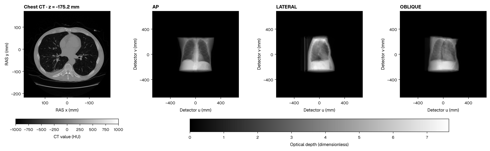

# DPT: Differentiable Photon Transport

Chris von Csefalvay Version 1.0.0

DPT projects physical attenuation volumes on CUDA and exposes volume/pose derivatives through PyTorch.

The manual covers [physical geometry](geometry.md), [PyTorch differentiation](pytorch.md), [spectral and transport models](components.md), and the [API and mathematics](reference/index.md). [Performance](performance.md) gives measured timings, and [citation](citation.md) provides software references.

## Getting started

[Install DPT and make a projection](getting-started/install.md) from a NIfTI or DICOM volume. The [worked CT example](applications/agentic-imaging.md) shows pose estimation with inspectable solver steps and rendered residuals.
