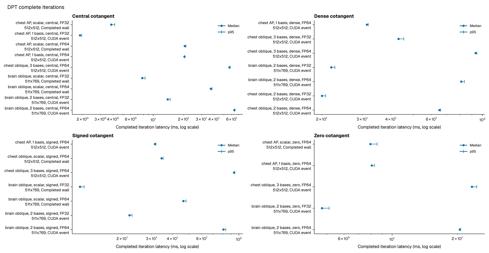
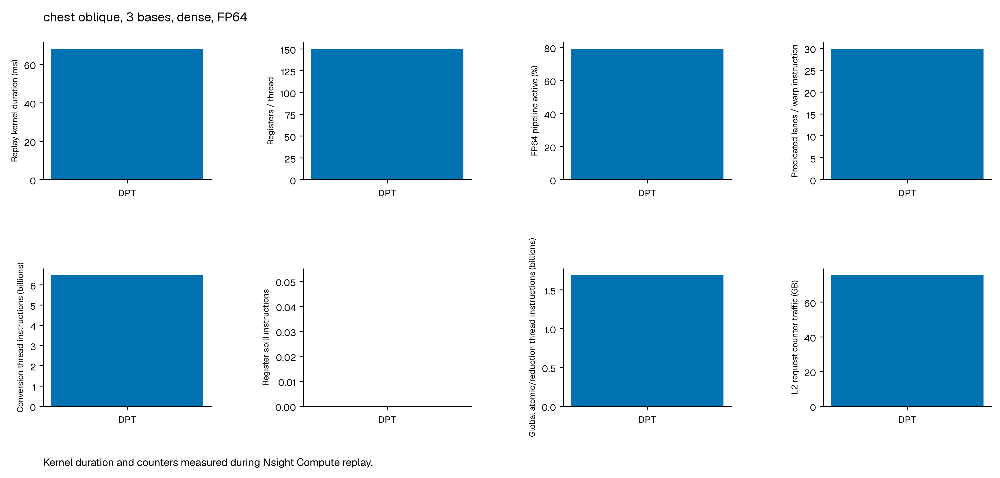
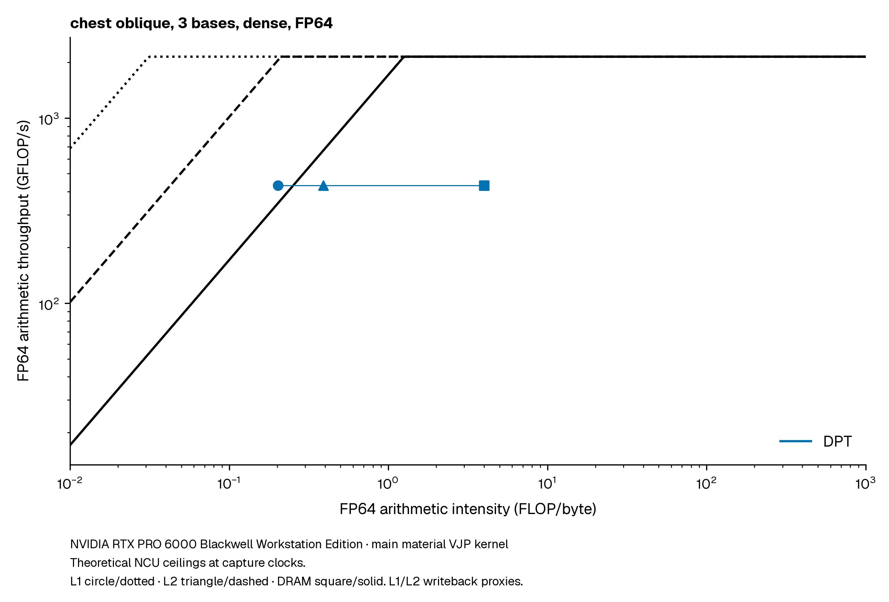

# Performance and reproduction

DPT measurements cover CT projection, volume and pose derivatives, and spectral material projection on an NVIDIA RTX PRO 6000 Blackwell Workstation Edition.

<!-- release:start -->

## CT projection and derivatives

NVIDIA RTX PRO 6000 Blackwell Workstation Edition. Complete real chest CT resampled to 256³ with its physical extent preserved. The acquisition uses 360 circular views, 512² detectors and 1024 clipped midpoint samples per ray. Completed resident PyTorch calls, median / p95 milliseconds from three rounds of ten samples. The complete iteration requests both volume and pose gradients.

| Precision | Forward (ms) | Volume VJP (ms) | Pose VJP (ms) | Full iteration (ms) |
|---|---|---|---|---|
| fp32 | 512.60 / 514.35 | 545.79 / 546.97 | 548.91 / 550.70 | 1475.54 / 1478.70 |
| fp64 | 4914.62 / 4920.19 | 4294.51 / 4312.27 | 9481.86 / 9522.05 | 16848.30 / 16869.51 |

See [ASTRA/TIGRE comparisons, errors and Nsight profiles](performance/fullscan.md).

<!-- release:end -->


The [full acquisition report](performance/fullscan.md) contains ASTRA and TIGRE comparisons, image errors, memory use, Nsight profiles and reproduction commands.

<!-- material:start -->

## Material projection performance

Measured 2026-10-19T17:13:00.054303+00:00 to 2026-10-19T17:35:56.835182+00:00.

Native chest and brain CT volumes use 1024 clipped midpoint samples per ray. Volume fields use FP32 storage. Each row specifies its FP32 or FP64 arithmetic.

Material densities are deterministic algebraic fields derived from `rho = max(1 + HU/1000, 0)`, with each channel cast to FP32. Scalar objectives use optical depth; material objectives use photon counts.

Each timing row contains 300 samples across 3 rounds. CUDA-event timings cover resident native operations and destination resets. Completed-wall timings cover the full PyTorch call, including validation and allocation.

### FP64 CUDA-event timing summary

| FP64 workload | Material VJP median / p95 (ms) | Spectral iteration median / p95 (ms) |
|---|---|---|
| 1 basis, AP, central region | 12.535 / 12.736 | 20.388 / 20.598 |
| 1 basis, AP, dense | 23.644 / 24.143 | 31.459 / 31.901 |
| 3 bases, oblique, central region | 34.028 / 34.073 | 56.860 / 58.006 |
| 3 bases, oblique, dense | 70.574 / 71.212 | 93.434 / 94.561 |

### Environment

| GPU | Driver | CUDA | Torch | Warp | Python |
|---|---|---|---|---|---|
| NVIDIA RTX PRO 6000 Blackwell Workstation Edition | 580.178.04 | 13.0 | 2.14.0 | 1.17.0 | 3.12.14 |



### Completed operation timings

| Case | Operation | Detector | Boundary | Median / p95 (ms) | Samples |
|---|---|---|---|---|---|
| chest AP, scalar, central, FP64 | Volume VJP | 512x512 | CUDA event | 3.624160 / 3.823678 | 300 |
| chest AP, scalar, central, FP64 | Pose VJP | 512x512 | CUDA event | 8.693632 / 8.901349 | 300 |
| chest AP, scalar, central, FP64 | PyTorch forward + volume/pose VJP | 512x512 | Completed wall | 20.512820 / 21.108925 | 300 |
| chest oblique, scalar, signed, FP64 | Volume VJP | 512x512 | CUDA event | 6.914576 / 7.237666 | 300 |
| chest oblique, scalar, signed, FP64 | Pose VJP | 512x512 | CUDA event | 17.161183 / 17.800938 | 300 |
| chest oblique, scalar, signed, FP64 | PyTorch forward + volume/pose VJP | 512x512 | Completed wall | 34.404109 / 35.252861 | 300 |
| chest AP, scalar, zero, FP64 | Volume VJP | 512x512 | CUDA event | 0.208608 / 0.215664 | 300 |
| chest AP, scalar, zero, FP64 | Pose VJP | 512x512 | CUDA event | 0.112576 / 0.117077 | 300 |
| chest AP, scalar, zero, FP64 | PyTorch forward + volume/pose VJP | 512x512 | Completed wall | 7.953309 / 8.546389 | 300 |
| chest AP, scalar, central, FP32 | Volume VJP | 512x512 | CUDA event | 0.958784 / 1.006842 | 300 |
| chest AP, scalar, central, FP32 | Pose VJP | 512x512 | CUDA event | 0.580912 / 0.623853 | 300 |
| chest AP, scalar, central, FP32 | PyTorch forward + volume/pose VJP | 512x512 | Completed wall | 3.834406 / 4.161676 | 300 |
| chest AP, 1 basis, central, FP64 | Material VJP | 512x512 | CUDA event | 12.534992 / 12.736191 | 300 |
| chest AP, 1 basis, central, FP64 | Spectral forward + volume/pose VJP | 512x512 | CUDA event | 20.387632 / 20.598017 | 300 |
| chest AP, 1 basis, dense, FP64 | Material VJP | 512x512 | CUDA event | 23.644480 / 24.143181 | 300 |
| chest AP, 1 basis, dense, FP64 | Spectral forward + volume/pose VJP | 512x512 | CUDA event | 31.458943 / 31.900960 | 300 |
| chest AP, 1 basis, signed, FP64 | Material VJP | 512x512 | CUDA event | 23.614177 / 24.142248 | 300 |
| chest AP, 1 basis, signed, FP64 | Spectral forward + volume/pose VJP | 512x512 | CUDA event | 31.449456 / 31.881157 | 300 |
| chest AP, 1 basis, zero, FP64 | Material VJP | 512x512 | CUDA event | 0.246496 / 0.251285 | 300 |
| chest AP, 1 basis, zero, FP64 | Spectral forward + volume/pose VJP | 512x512 | CUDA event | 8.065136 / 8.305459 | 300 |
| chest oblique, 3 bases, central, FP64 | Material VJP | 512x512 | CUDA event | 34.027985 / 34.073300 | 300 |
| chest oblique, 3 bases, central, FP64 | Spectral forward + volume/pose VJP | 512x512 | CUDA event | 56.859600 / 58.005797 | 300 |
| chest oblique, 3 bases, dense, FP64 | Material VJP | 512x512 | CUDA event | 70.573837 / 71.212000 | 300 |
| chest oblique, 3 bases, dense, FP64 | Spectral forward + volume/pose VJP | 512x512 | CUDA event | 93.434254 / 94.561210 | 300 |
| chest oblique, 3 bases, signed, FP64 | Material VJP | 512x512 | CUDA event | 70.649216 / 71.330246 | 300 |
| chest oblique, 3 bases, signed, FP64 | Spectral forward + volume/pose VJP | 512x512 | CUDA event | 93.530338 / 94.645983 | 300 |
| chest oblique, 3 bases, zero, FP64 | Material VJP | 512x512 | CUDA event | 0.596704 / 0.689842 | 300 |
| chest oblique, 3 bases, zero, FP64 | Spectral forward + volume/pose VJP | 512x512 | CUDA event | 23.372896 / 24.602600 | 300 |
| chest AP, 1 basis, central, FP32 | Material VJP | 512x512 | CUDA event | 1.304448 / 1.377542 | 300 |
| chest AP, 1 basis, central, FP32 | Spectral forward + volume/pose VJP | 512x512 | CUDA event | 1.881184 / 1.957459 | 300 |
| chest oblique, 3 bases, dense, FP32 | Material VJP | 512x512 | CUDA event | 38.180336 / 40.943020 | 300 |
| chest oblique, 3 bases, dense, FP32 | Spectral forward + volume/pose VJP | 512x512 | CUDA event | 43.186159 / 45.555466 | 300 |
| brain oblique, scalar, central, FP64 | Volume VJP | 511x769 | CUDA event | 8.689488 / 9.729094 | 300 |
| brain oblique, scalar, central, FP64 | Pose VJP | 511x769 | CUDA event | 16.104096 / 16.485362 | 300 |
| brain oblique, scalar, central, FP64 | PyTorch forward + volume/pose VJP | 511x769 | Completed wall | 37.189773 / 38.224703 | 300 |
| brain oblique, scalar, signed, FP64 | Volume VJP | 511x769 | CUDA event | 13.609776 / 14.720797 | 300 |
| brain oblique, scalar, signed, FP64 | Pose VJP | 511x769 | CUDA event | 22.166320 / 23.348969 | 300 |
| brain oblique, scalar, signed, FP64 | PyTorch forward + volume/pose VJP | 511x769 | Completed wall | 46.508984 / 48.300942 | 300 |
| brain oblique, 2 bases, central, FP64 | Material VJP | 511x769 | CUDA event | 43.301489 / 44.121326 | 300 |
| brain oblique, 2 bases, central, FP64 | Spectral forward + volume/pose VJP | 511x769 | CUDA event | 63.593088 / 64.386981 | 300 |
| brain oblique, 2 bases, dense, FP64 | Material VJP | 511x769 | CUDA event | 60.637264 / 63.246855 | 300 |
| brain oblique, 2 bases, dense, FP64 | Spectral forward + volume/pose VJP | 511x769 | CUDA event | 80.923424 / 83.557179 | 300 |
| brain oblique, 2 bases, signed, FP64 | Material VJP | 511x769 | CUDA event | 60.620657 / 63.227094 | 300 |
| brain oblique, 2 bases, signed, FP64 | Spectral forward + volume/pose VJP | 511x769 | CUDA event | 80.809792 / 83.535182 | 300 |
| brain oblique, 2 bases, zero, FP64 | Material VJP | 511x769 | CUDA event | 0.302592 / 0.314838 | 300 |
| brain oblique, 2 bases, zero, FP64 | Spectral forward + volume/pose VJP | 511x769 | CUDA event | 20.521760 / 20.739012 | 300 |
| chest oblique, 2 bases, dense, FP64 | Material VJP | 512x512 | CUDA event | 48.578945 / 48.948202 | 300 |
| chest oblique, 2 bases, dense, FP64 | Spectral forward + volume/pose VJP | 512x512 | CUDA event | 64.994301 / 65.866637 | 300 |
| brain oblique, scalar, central, FP32 | Volume VJP | 511x769 | CUDA event | 3.501136 / 3.758800 | 300 |
| brain oblique, scalar, central, FP32 | Pose VJP | 511x769 | CUDA event | 0.693280 / 0.791816 | 300 |
| brain oblique, scalar, central, FP32 | PyTorch forward + volume/pose VJP | 511x769 | Completed wall | 7.791426 / 8.307752 | 300 |
| brain oblique, scalar, signed, FP32 | Volume VJP | 511x769 | CUDA event | 6.754608 / 7.074941 | 300 |
| brain oblique, scalar, signed, FP32 | Pose VJP | 511x769 | CUDA event | 1.301696 / 1.411189 | 300 |
| brain oblique, scalar, signed, FP32 | PyTorch forward + volume/pose VJP | 511x769 | Completed wall | 11.180524 / 11.839446 | 300 |
| brain oblique, 2 bases, central, FP32 | Material VJP | 511x769 | CUDA event | 9.259248 / 10.142822 | 300 |
| brain oblique, 2 bases, central, FP32 | Spectral forward + volume/pose VJP | 511x769 | CUDA event | 13.915840 / 14.746566 | 300 |
| brain oblique, 2 bases, dense, FP32 | Material VJP | 511x769 | CUDA event | 17.363472 / 18.106761 | 300 |
| brain oblique, 2 bases, dense, FP32 | Spectral forward + volume/pose VJP | 511x769 | CUDA event | 22.028608 / 22.846754 | 300 |
| brain oblique, 2 bases, signed, FP32 | Material VJP | 511x769 | CUDA event | 17.467953 / 18.129809 | 300 |
| brain oblique, 2 bases, signed, FP32 | Spectral forward + volume/pose VJP | 511x769 | CUDA event | 22.132672 / 22.923679 | 300 |
| brain oblique, 2 bases, zero, FP32 | Material VJP | 511x769 | CUDA event | 0.140576 / 0.148213 | 300 |
| brain oblique, 2 bases, zero, FP32 | Spectral forward + volume/pose VJP | 511x769 | CUDA event | 4.751552 / 5.130721 | 300 |
| chest oblique, 2 bases, dense, FP32 | Material VJP | 512x512 | CUDA event | 16.344656 / 17.228015 | 300 |
| chest oblique, 2 bases, dense, FP32 | Spectral forward + volume/pose VJP | 512x512 | CUDA event | 20.056976 / 20.803224 | 300 |

### Numerical checks

| Case | Objective units | Adjoint relative | Volume FD relative | Pose FD relative | Pose step |
|---|---|---|---|---|---|
| chest AP, scalar, central, FP64 | optical depth | 2.78091e-16 | 3.72211e-14 | 5.25512e-06 | 1e-06 |
| chest oblique, scalar, signed, FP64 | optical depth | 7.48427e-15 | 5.06613e-13 | 7.05781e-06 | 1e-06 |
| chest AP, scalar, zero, FP64 | optical depth | 0 | 0 | 0 | 1e-06 |
| chest AP, scalar, central, FP32 | optical depth | 2.08756e-09 | 1.218e-06 | 0.00552385 | 0.02 |
| chest AP, 1 basis, central, FP64 | photons | 1.40369e-16 | 1.14464e-06 | 2.85659e-05 | 1e-06 |
| chest AP, 1 basis, dense, FP64 | photons | 3.88253e-16 | 9.3077e-07 | 2.19099e-05 | 1e-06 |
| chest AP, 1 basis, signed, FP64 | photons | 0 | 4.17638e-07 | 0.000148647 | 1e-06 |
| chest AP, 1 basis, zero, FP64 | photons | 0 | 0 | 0 | 1e-06 |
| chest oblique, 3 bases, central, FP64 | photons | 2.21723e-16 | 1.00141e-06 | 1.42714e-06 | 1e-06 |
| chest oblique, 3 bases, dense, FP64 | photons | 5.36831e-16 | 1.746e-06 | 3.03452e-06 | 1e-06 |
| chest oblique, 3 bases, signed, FP64 | photons | 1.6043e-15 | 1.03338e-06 | 3.48742e-06 | 1e-06 |
| chest oblique, 3 bases, zero, FP64 | photons | 0 | 0 | 0 | 1e-06 |
| chest AP, 1 basis, central, FP32 | photons | 1.50438e-09 | 6.83943e-06 | 0.00754484 | 0.02 |
| chest oblique, 3 bases, dense, FP32 | photons | 1.15045e-09 | 8.96552e-06 | 0.00369915 | 0.02 |
| brain oblique, scalar, central, FP64 | optical depth | 1.6706e-16 | 9.83385e-15 | 1.73828e-05 | 1e-06 |
| brain oblique, scalar, signed, FP64 | optical depth | 1.42335e-15 | 5.5098e-13 | 1.89021e-06 | 1e-06 |
| brain oblique, 2 bases, central, FP64 | photons | 4.55052e-16 | 6.48767e-07 | 2.35214e-06 | 1e-06 |
| brain oblique, 2 bases, dense, FP64 | photons | 4.47785e-16 | 4.52699e-07 | 3.08761e-06 | 1e-06 |
| brain oblique, 2 bases, signed, FP64 | photons | 1.28961e-15 | 8.54368e-08 | 1.15457e-06 | 1e-06 |
| brain oblique, 2 bases, zero, FP64 | photons | 0 | 0 | 0 | 1e-06 |
| chest oblique, 2 bases, dense, FP64 | photons | 2.83445e-16 | 2.17607e-06 | 6.38565e-06 | 1e-06 |
| brain oblique, scalar, central, FP32 | optical depth | 1.02979e-09 | 2.19494e-08 | 0.0101769 | 0.02 |
| brain oblique, scalar, signed, FP32 | optical depth | 1.46039e-07 | 2.07531e-05 | 0.00566456 | 0.02 |
| brain oblique, 2 bases, central, FP32 | photons | 3.41466e-09 | 3.09006e-06 | 0.00877991 | 0.02 |
| brain oblique, 2 bases, dense, FP32 | photons | 4.0044e-09 | 1.25357e-06 | 0.013836 | 0.02 |
| brain oblique, 2 bases, signed, FP32 | photons | 7.37938e-08 | 6.17975e-06 | 0.00647601 | 0.02 |
| brain oblique, 2 bases, zero, FP32 | photons | 0 | 0 | 0 | 0.02 |
| chest oblique, 2 bases, dense, FP32 | photons | 6.15856e-10 | 2.54595e-05 | 0.00376291 | 0.02 |

### Material kernel counters

| Native case | FP64 ADD/MUL/FMA FLOPs | Conversions | Atomics | Registers/thread | FP64 pipe active | Classified spills | Local load / store B |
|---|---|---|---|---|---|---|---|
| M1 AP central | 6,576,342,736 | 1,210,392,576 | 301,989,888 | 136 | 80.64% | 0 | 0 / 0 |
| M3 oblique dense | 29,441,264,416 | 6,461,208,476 | 1,684,881,408 | 150 | 79.12% | 0 | 0 / 0 |





### 32-basis analytic diagnostic

An oblique 8 × 10 × 12 analytic field, a 33 × 49 detector and 32 material channels use 128 clipped midpoint samples with dense cotangents.

| Main-kernel metric | DPT |
|---|---|
| registers_per_thread | 147 |
| register_spill_instructions | 0 |
| local_load_sector_bytes | 53,215,232 |
| local_store_sector_bytes | 841,728 |
| fp64_add_mul_fma_flops | 838,551,972 |
| global_atomic_and_reduction_thread_instructions | 52,985,856 |

FLOPs count predicated-thread ADD + MUL + 2 × FMA. Conversion and atomic instructions are reported separately. Local-memory sector bytes count load and store traffic; classified spills count register-spill instructions.

Roofline ceilings use the theoretical NCU model at the recorded capture clocks. The L1 and L2 intensities use writeback traffic proxies.

<!-- material:end -->

## Measurement files and reproduction

[Material timing samples and physical configuration](assets/results/material/results.json), [numerical checks](assets/results/material/checks.csv), [kernel counters](assets/results/material/profiles.json) and the [32-basis diagnostic](assets/results/material/material32-diagnostic.json) provide the underlying measurements.

Regenerate the material tables and figures from these files:

```bash
python tools/material_report.py \
  --output /tmp/dpt-material-report \
  --check-page docs/performance.md
```

Choose a new output directory for each report. The [CT acquisition commands](performance/fullscan.md#reproduce-the-acquisition) prepare the volume and run projection, derivative and profiling measurements.
