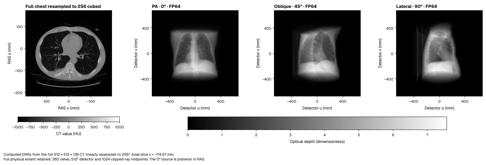
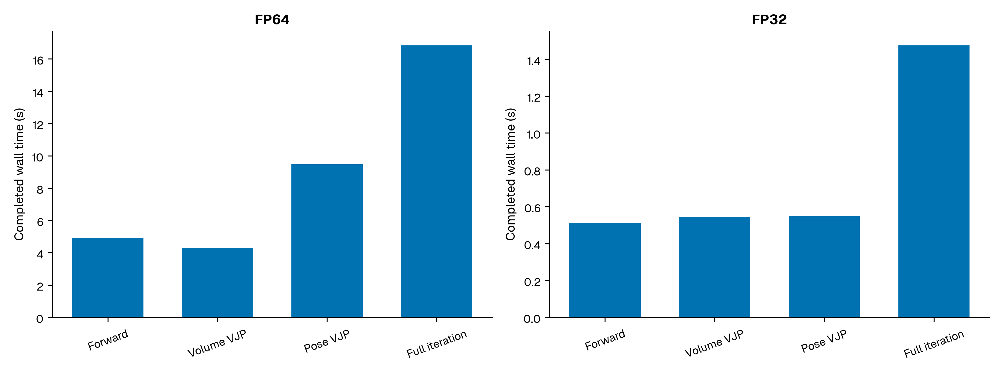
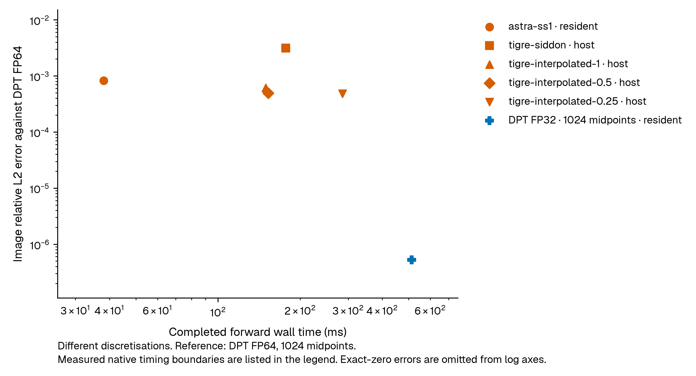
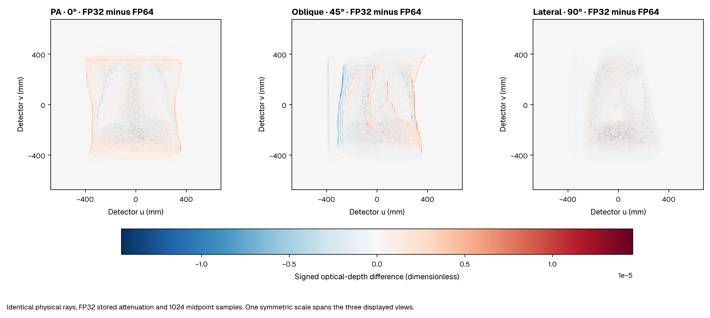
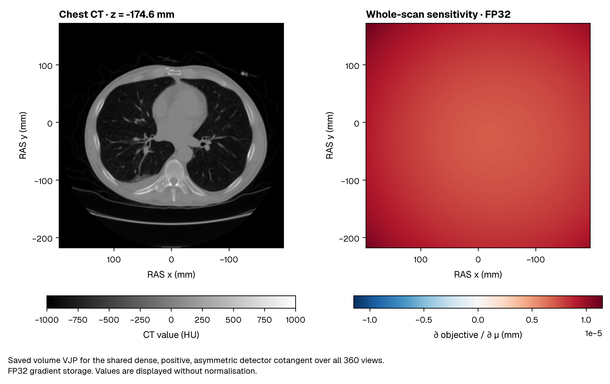
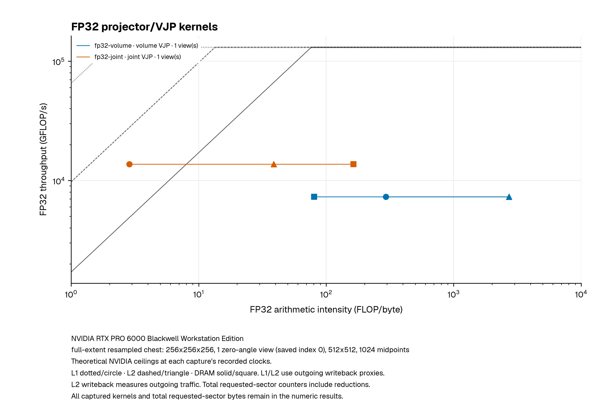
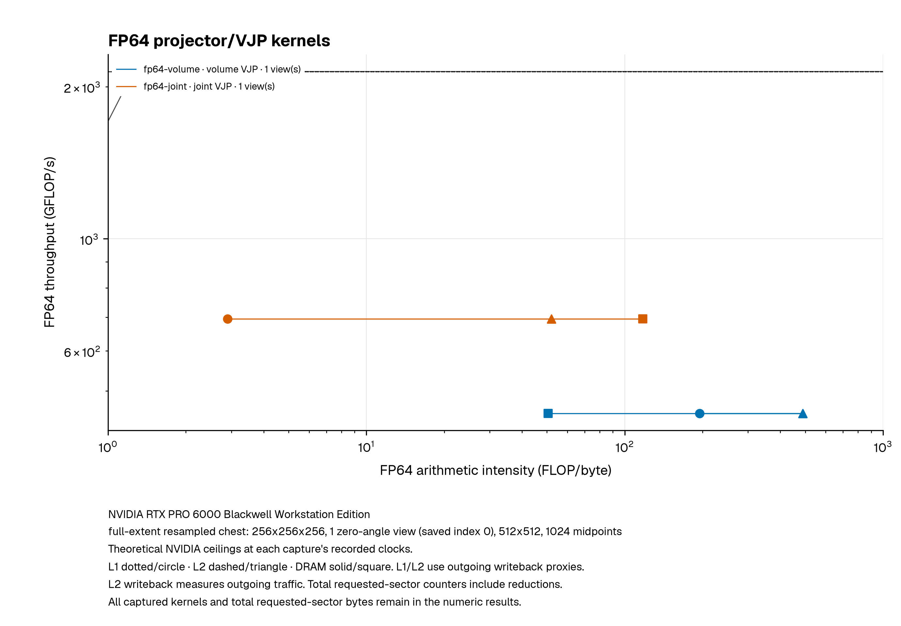

# Full chest, 360 views

This acquisition uses the complete Slicer CTChest resampled to **256 × 256 × 256**,
with **360 circular views and 512 × 512 detector pixels**. Resampling preserves
the original voxel-face extent and physical transform. The native scan is
512 × 512 × 139.

The two DPT modes use the same FP32 attenuation field, physical rays, clipping,
trilinear interpolation and 1024 midpoint samples per clipped ray. `fp32` is the
FP32 sample-arithmetic path. `fp64` uses FP64 geometry, sample arithmetic and
accumulation. Both read the stored FP32 field.

## Physical settings

| Setting | Value |
|---|---|
| Resampling | Linear HU interpolation, clamped edges, original voxel-face extent preserved |
| Derived voxel pitch, x/y/z | 1.5234379768371582 / 1.5234379768371582 / 1.357421875 mm |
| Source to centre / source to detector | 600 / 1200 mm |
| Detector pitch | 2.6375731636032262 mm |
| Orbit | World Z, angles 2πk/360, k = 0…359 |
| Zero-angle ray | Posterior source, PA direction, detector columns +X and rows +Z in RAS |
| Attenuation model | max(1 + HU/1000, 0) × 0.02059 mm⁻¹ at 60 keV |
| Output | Dimensionless optical depth |

All derivative timings use the saved dense asymmetric detector cotangent.
Volume VJP, pose VJP, fresh forward plus volume-only backward and fresh forward
plus both gradients are separate operations. The pose is fixed at identity for timing. Independent finite
differences use a nonidentity pose with fixed, recorded finite-difference steps.

## Reading the comparisons

Resident DPT calls include the public PyTorch adapter's validation and completed
CUDA work. Device arrays are already present. CUDA events use the Torch stream
bridged to Warp. Completed wall time is reported alongside device time. Three
independent rounds retain every sample. Logging and output writes occur outside
the timed region.

ASTRA uses native CUDA forward/backprojection with zero-copy DLPack linking.
TIGRE's native host boundary includes array transfers; its PyTorch wrapper uses
the matched backprojector. All reported wall times cover completed calls.

Image errors use DPT FP64 on the shared field and rays. The measured adjoint
defect tests each backend's forward/backprojection pair. Competitor iterations
request volume gradients; DPT reports both volume-only and joint volume/pose
iterations. Each row identifies its discretisation and timing boundary.

## Reproduce the acquisition

Keep prepared volumes and results outside the repository. From a source checkout
with the imaging, Torch and benchmark dependencies installed:

```bash
python tools/download_samples.py chest --data-dir "$HOME/.cache/dpt/samples"
python -m benchmarks.prepare_fullscan \
  --ct "$HOME/.cache/dpt/samples/CTChest.nii.gz" \
  --source-nrrd "$HOME/.cache/dpt/samples/CTChest.nrrd" \
  --output "$HOME/dpt-results/fullscan-input"

python -m benchmarks.fullscan --source . --precision fp64 \
  --data "$HOME/dpt-results/fullscan-input/inputs" \
  --cotangent "$HOME/dpt-results/fullscan-input/cotangent.npy" \
  --contract "$HOME/dpt-results/fullscan-input/contract.json" \
  --rounds 3 --repeats 10 --output "$HOME/dpt-results/fullscan-fp64"
python -m benchmarks.fullscan --source . --precision fp32 \
  --data "$HOME/dpt-results/fullscan-input/inputs" \
  --cotangent "$HOME/dpt-results/fullscan-input/cotangent.npy" \
  --contract "$HOME/dpt-results/fullscan-input/contract.json" \
  --reference "$HOME/dpt-results/fullscan-fp64" \
  --rounds 3 --repeats 10 --output "$HOME/dpt-results/fullscan-fp32"

python -m benchmarks.fullscan_competitors --source . \
  --input "$HOME/dpt-results/fullscan-input/inputs" \
  --cotangent "$HOME/dpt-results/fullscan-input/cotangent.npy" \
  --reference-image "$HOME/dpt-results/fullscan-fp64/images.npy" \
  --reference-gradient "$HOME/dpt-results/fullscan-fp64/volume_vjp.npy" \
  --backends astra --boundaries resident torch host \
  --output "$HOME/dpt-results/fullscan-astra"
```

The preparation command writes a new settings manifest and exact detector
cotangent bound to the prepared volume. Measurement dates identify when each
benchmark ran.

Run the commands sequentially on an otherwise quiet GPU. Install ASTRA and TIGRE
in their own environments. Use `--backends tigre-siddon
--boundaries host torch` for the matched TIGRE calculation. The interpolation
sweep uses `--backends tigre-interpolated --boundaries host --operations forward
--tigre-accuracy 1 0.5 0.25`. Give every invocation a new output directory.

Run `benchmarks.fullscan_guards` with the same data, cotangent and contract,
`--guard-contract benchmarks/config/fullscan_guards.json`, and each precision to
repeat the independent rays and directional derivatives. `benchmarks.fullscan_quality`
repeats the four sample counts against the saved FP64 run. `benchmarks.fullscan_cold`
uses separate fresh and reused cache processes. Each command's `--help` lists
its required output/reference arguments.

## Reproduce volume-only iterations

The volume-only timer makes a fresh `Projector` forward call and requests the
field gradient through `torch.autograd.grad`. Inputs stay on CUDA. The timed
interval includes output and gradient allocation, internal validation, stream
bridges and completion. Upload, correctness reductions and file writes occur
outside that interval.

```bash
python -m benchmarks.fullscan_volume_iteration --helper-source . \
  --source . --precision fp32 \
  --data "$HOME/dpt-results/fullscan-input/inputs" \
  --cotangent "$HOME/dpt-results/fullscan-input/cotangent.npy" \
  --contract "$HOME/dpt-results/fullscan-input/contract.json" \
  --samples 1024 --rounds 3 --repeats 10 \
  --reference "$HOME/dpt-results/fullscan-fp32" \
  --output "$HOME/dpt-results/volume-fp32-1024"
```

Repeat with `--precision fp64`, the FP64 reference directory and a new output
directory for the strict arithmetic path. The timer checks the real-volume
adjoint and binds the saved reference to the field, rays, cotangent and sample
count. Each result contains completed wall times and CUDA-event times from the
owning Torch stream.

## Reproduce the profiling captures

`benchmarks.fullscan_profile` uses the same prepared field, 1024 midpoint samples,
identity pose and saved detector cotangent. `--gradients volume` profiles
volume-only backward without a pose tensor. `--gradients both` profiles joint
volume/pose backward and remains the default. The probe warms the selected
forward/backward pair, counts status readbacks in a separate call pair, then opens
`probe_forward` and `probe_backward` NVTX ranges. Requested gradients are recorded
explicitly. A subset of views uses the corresponding entries of the saved seed
with their original normalisation. Source line information is enabled
before DPT's Warp kernels are imported. `probe.json` records the actual source,
input metadata, helper/seed hashes, selected indices, dates and status counts.

Inspect the installed tools before selecting their sections and counters:

```bash
nvidia-smi
nsys --version
ncu --version
ncu --list-sections
ncu --query-metrics --query-metrics-mode all --devices 0
```

The following Nsight Compute command captures **one complete backward operation
for one saved zero-angle view**, requesting volume gradients only and including
its validation kernels.
Use the corresponding forward range for forward profiling, and repeat both
precisions with separate output names. The listed sections and counters were
recorded with Nsight Compute 2026.3.1.

```bash
mkdir -p "$HOME/dpt-results/fullscan-profiles"
ncu --profile-from-start off --nvtx --nvtx-push-pop-scope process \
  --nvtx-include 'probe_backward/' \
  --replay-mode kernel --cache-control all --clock-control none \
  --import-source yes \
  --section SpeedOfLight --section LaunchStats --section Occupancy \
  --section MemoryWorkloadAnalysis --section ComputeWorkloadAnalysis \
  --section InstructionStats --section SchedulerStats \
  --section SourceCounters --section WarpStateStats \
  --section SpeedOfLight_HierarchicalSingleRooflineChart \
  --section SpeedOfLight_HierarchicalDoubleRooflineChart \
  --metrics dram__bytes.sum,l1tex__t_bytes.sum,lts__t_bytes.sum,smsp__sass_thread_inst_executed_op_fadd_pred_on.sum,smsp__sass_thread_inst_executed_op_fmul_pred_on.sum,smsp__sass_thread_inst_executed_op_ffma_pred_on.sum,smsp__sass_thread_inst_executed_op_dadd_pred_on.sum,smsp__sass_thread_inst_executed_op_dmul_pred_on.sum,smsp__sass_thread_inst_executed_op_dfma_pred_on.sum,sass__thread_inst_executed_true_per_opcode,sass__thread_inst_executed_per_opcode_category,sass__inst_executed_register_spilling \
  -o "$HOME/dpt-results/fullscan-profiles/fp64-one-view-volume" \
  python -m benchmarks.fullscan_profile --source . \
  --data "$HOME/dpt-results/fullscan-input/inputs" \
  --cotangent "$HOME/dpt-results/fullscan-input/cotangent.npy" \
  --views 1 --precision fp64 --gradients volume --profile --repeats 1 \
  --output "$HOME/dpt-results/fullscan-profiles/fp64-one-view-volume-probe"
```

Process-wide NVTX selection includes CUDA launches made by PyTorch's autograd
worker thread. With `--repeats 1`, the probe emits one complete matching backward
range after warmup.

Nsight Systems records the complete **360-view forward/backward pair** after
warmup. This command selects volume-only backward. Repeat with `--gradients both`
and new output names for joint backward. The profiler API capture range excludes
preparation and status counting:

```bash
nsys profile --trace=cuda,nvtx,osrt --sample=none --cpuctxsw=none \
  --capture-range=cudaProfilerApi --capture-range-end=stop \
  -o "$HOME/dpt-results/fullscan-profiles/fp64-360-volume" \
  python -m benchmarks.fullscan_profile --source . \
  --data "$HOME/dpt-results/fullscan-input/inputs" \
  --cotangent "$HOME/dpt-results/fullscan-input/cotangent.npy" \
  --views 360 --precision fp64 --gradients volume --profile --repeats 1 \
  --output "$HOME/dpt-results/fullscan-profiles/fp64-360-volume-probe"

nsys export --type sqlite \
  --output "$HOME/dpt-results/fullscan-profiles/fp64-360-volume.sqlite" \
  "$HOME/dpt-results/fullscan-profiles/fp64-360-volume.nsys-rep"
python -m benchmarks.fullscan_timeline \
  --sqlite "$HOME/dpt-results/fullscan-profiles/fp64-360-volume.sqlite" \
  --metadata "$HOME/dpt-results/fullscan-profiles/fp64-360-volume-probe/probe.json" \
  --profile-harness benchmarks/fullscan_profile.py \
  --output "$HOME/dpt-results/fullscan-profiles/fp64-360-volume-timeline"
```

Keep the exact probe script used for a capture: the timeline reader verifies its
hash. Export Compute reports with `ncu --import REPORT --csv --print-units base
--page raw`. Use the actual `.ncu-rep` or `.ncu-repz` filename written by that
installation. `--page source --print-source cuda,sass` exports source/SASS, and
`--print-metric-instances details` retains the opcode-instance counters.

Run captures sequentially on an otherwise quiet GPU. Nsight Compute reports
replay kernel time; Nsight Systems reports instrumented application intervals.
The benchmark commands above supply completed-call medians and p95 values.

`tools/fullscan_profile_report.py` reads saved capture directories, metadata and
exported counters. Supply each capture with `--capture LABEL=PATH` and each
completed Systems analysis with `--timeline LABEL=JSON`. Use distinct labels for
volume-only and joint-gradient captures, and `--font PATH` for a local Geist font.

## Regenerate the published report

The following command rebuilds the timing tables and figures from the packaged
measurements:

```bash
python tools/fullscan_report.py \
  --results docs/assets/results/fullscan/measurements.json \
  --fonts "$HOME/.cache/dpt/fonts" \
  --output "$HOME/dpt-results/fullscan-report"
```

The report files retain source digests, measurement dates and raw samples.

<!-- fullscan-results:start -->

## Measured results

NVIDIA RTX PRO 6000 Blackwell Workstation Edition. Complete real chest CT resampled to 256³ with its physical extent preserved. The acquisition uses 360 circular views, 512² detectors and 1024 clipped midpoint samples per ray. Completed resident PyTorch calls, median / p95 milliseconds from three rounds of ten samples. The complete iteration requests both volume and pose gradients.

Measured: 2026-10-20T03:31:19.747136+00:00 to 2026-10-20T03:54:56.711605+00:00.

[Numeric results and raw samples](../assets/results/fullscan/measurements.json) record source digests, physical settings, versions and hardware telemetry. NVML reports sampled process memory, including Warp allocations.



## DPT: completed resident PyTorch calls

| Arithmetic | Operation | Median / p95 (ms) | Sampled process VRAM (GiB) |
|---|---|---|---|
| FP64 | Forward | 4914.62 / 4920.19 | 2.83 |
| FP64 | Volume VJP | 4294.51 / 4312.27 | 2.83 |
| FP64 | Pose VJP | 9481.86 / 9522.05 | 2.91 |
| FP64 | Forward + volume/pose VJP | 16848.30 / 16869.51 | 3.68 |
| FP32 | Forward | 512.60 / 514.35 | 1.78 |
| FP32 | Volume VJP | 545.79 / 546.97 | 1.78 |
| FP32 | Pose VJP | 548.91 / 550.70 | 1.86 |
| FP32 | Forward + volume/pose VJP | 1475.54 / 1478.70 | 2.27 |

## ASTRA and TIGRE: their native algorithms

| Implementation | Boundary | Operation | Rounds × repeats | Median / p95 (ms) | Sampled process VRAM (GiB) | Image relative L2 vs DPT FP64 | Measured adjoint defect |
|---|---|---|---|---|---|---|---|
| astra-ss1 | resident | forward | 3 × 100 | 38.10 / 38.48 | 1.87 | 0.000827 | 0.0273 |
| astra-ss1 | resident | backprojection | 3 × 100 | 9.07 / 9.53 | 2.16 | 0.000827 | 0.0273 |
| astra-ss1 | torch | forward | 3 × 100 | 38.31 / 38.88 | 1.87 | 0.000827 | 0.0273 |
| astra-ss1 | torch | backprojection | 3 × 100 | 9.10 / 9.24 | 2.16 | 0.000827 | 0.0273 |
| astra-ss1 | torch | iteration | 3 × 100 | 49.81 / 50.65 | 2.86 | 0.000827 | 0.0273 |
| astra-ss1 | host | forward | 3 × 100 | 94.99 / 98.36 | 1.10 | 0.000827 | 0.0273 |
| astra-ss1 | host | backprojection | 3 × 100 | 98.75 / 111.83 | 1.37 | 0.000827 | 0.0273 |
| tigre-siddon | torch | forward | 3 × 10 | 227.63 / 232.50 | 1.66 | 0.00315 | 8.7e-05 |
| tigre-siddon | torch | backprojection | 3 × 10 | 239.30 / 254.08 | 1.66 | 0.00315 | 8.7e-05 |
| tigre-siddon | torch | iteration | 3 × 10 | 481.82 / 507.62 | 1.81 | 0.00315 | 8.7e-05 |
| tigre-siddon | host | forward | 3 × 100 | 177.07 / 182.56 | 0.63 | 0.00315 | 8.7e-05 |
| tigre-siddon | host | backprojection | 3 × 100 | 67.83 / 71.69 | 0.63 | 0.00315 | 8.7e-05 |
| tigre-interpolated-1 | host | forward | 3 × 100 | 149.74 / 163.98 | 0.54 | 0.000614 | — |
| tigre-interpolated-0.5 | host | forward | 3 × 100 | 152.87 / 160.88 | 0.54 | 0.000494 | — |
| tigre-interpolated-0.25 | host | forward | 3 × 10 | 285.95 / 288.46 | 0.54 | 0.000482 | — |

Image and backprojection errors use the saved FP64 arrays identified in [the numerical reference manifest](../assets/results/fullscan/competitor_reference.json). DPT's complete iteration requests both volume and pose gradients. Competitor iterations request volume gradients only. The volume-only table below gives the corresponding DPT measurement.


ASTRA uses cuda3d native slice traversal and voxel-driven backprojection, with detector and voxel supersampling both set to one. Its resident rows link CUDA arrays through DLPack. TIGRE Siddon uses piecewise-constant voxel intersections and explicit `Atb(backprojection_type='matched')`. Its interpolation rows vary the native `accuracy` setting. TIGRE Torch rows include the installed wrapper's host staging and required native transfers. All rows report completed wall time and sampled NVML process memory.


## Numerical agreement

| Arithmetic | Image identical to same-mode reference | Volume VJP relative L2 vs reference | Volume adjoint discrepancy |
|---|---|---|---|
| FP64 | True | 6.83789e-08 | 5.16702e-11 |
| FP32 | True | 4.62664e-08 | 3.49037e-10 |

FP32 against FP64 on the same stored field and physical rays: maximum optical-depth error 2.26569e-05, RMSE 9.92433e-07, relative L2 5.2597e-07. These measurements describe this resampled chest and acquisition.
This untimed comparison uses the selected runs' saved images and their recorded NPY and raw-array checksums. Its plot point uses the measured FP32 forward median.


Nonidentity-pose guards use views 0, 37 and 113, the fixed asymmetric detector objective and the saved finite-difference steps. Volume differences account for the realised FP32 input perturbation. Independent CPU rays use an explicit slab intersection and eight interpolation weights.

| Arithmetic | Volume FD absolute error | Volume error bound | Pose FD absolute error | Pose error bound | CPU ray max absolute error |
|---|---|---|---|---|---|
| FP32 | 2.23742e-08 | 5.20989e-05 | 5.54787e-07 | 4.48884e-05 | 3.6849e-06 |
| FP64 | 2.58342e-13 | 2.14396e-07 | 1.97916e-10 | 6.32217e-06 | 7.10543e-15 |

## Fresh-process startup

Each precision has three independent empty-cache processes, each followed by a new process reusing that pair of compilation caches. The first-image clock starts at benchmark child entry, after interpreter startup and initial standard-library imports. It includes scientific-package imports, CUDA initialisation, loading the prepared attenuation field, upload, module construction and the first completed public projection. Lazy workspace preparation and JIT are inside the first public call. Original CT resampling/calibration, output download and subsequent correctness checks are outside the interval. The OS filesystem cache remains in its observed state.

| Arithmetic | New-process cache state | Processes | First device image median / p95 (s) | First public forward median / p95 (s) | Warm completed wall median / p95 (ms) |
|---|---|---|---|---|---|
| FP64 | Empty compilation caches | 3 | 7.115 / 7.140 | 6.075 / 6.098 | 4881.53 / 4914.38 |
| FP64 | Reused compilation caches | 3 | 6.463 / 6.560 | 5.445 / 5.523 | 4913.73 / 4920.32 |
| FP32 | Empty compilation caches | 3 | 2.888 / 2.944 | 1.813 / 1.845 | 509.60 / 512.15 |
| FP32 | Reused compilation caches | 3 | 2.094 / 2.109 | 1.047 / 1.057 | 511.09 / 564.48 |

Warm rows pool three calls per process. The reported p95 values are sample quantiles. First-image p95 uses three processes. Raw phase timings, module events and actual process dates remain in the compact results. Measurement intervals: 2026-10-20T03:56:17.356468+00:00 to 2026-10-20T03:59:17.016647+00:00.


## Full-scan volume-only iterations

GPU: NVIDIA RTX PRO 6000 Blackwell Workstation Edition. Complete chest resampled to 256³, with 360 views at 512².

Each completed iteration requests volume gradients only. DPT uses a fresh forward graph and the exact realised sampling transpose. Inputs stay on CUDA.

| Implementation | Algorithm / sampling | Boundary | Wall median ms | Wall p95 ms | Event median ms | Event p95 ms | Sampled process GiB |
|---|---|---|---|---|---|---|---|
| DPT | FP32 midpoint, 1024 | CUDA resident | 1058 | 1060.35 | 1058.01 | 1060.36 | 1.61133 |
| astra-ss1 | ASTRA cuda3d native forward and voxel-driven native backprojection | benchmark autograd adapter around resident direct_FP/direct_BP | 49.8062 | 50.655 | unavailable | unavailable | 2.86133 |
| tigre-siddon | TIGRE Siddon forward. explicit matched native Atb | shipped TIGRE Torch A forward. adapter uses explicit matched Atb backward | 481.821 | 507.618 | unavailable | unavailable | 1.80859 |

Wall timings cover completed calls. Device events use the owning CUDA stream where recorded. NVML memory is the largest sampled process allocation.

### Numerical checks

| Run | Adjoint relative discrepancy | Volume VJP relative L2 vs same-sample reference |
|---|---|---|
| DPT N1024 | 3.46252e-10 | 4.62702e-08 |

### Alternative algorithms

| Tested adapter | Image relative L2 vs DPT FP64 N1024 | BP relative L2 vs DPT FP64 N1024 VJP | Measured adjoint defect |
|---|---|---|---|
| astra-ss1 | 0.000826789 | 0.0438604 | 0.0272748 |
| tigre-siddon | 0.00314858 | 0.00591296 | 8.69585e-05 |
| tigre-interpolated-1 | 0.000613616 | unavailable | unavailable |
| tigre-interpolated-0.5 | 0.000493744 | unavailable | unavailable |
| tigre-interpolated-0.25 | 0.000482204 | unavailable | unavailable |

Image and backprojection differences use the recorded DPT FP64 1024-midpoint calculation. The adjoint defect tests each backend's own forward/backprojection pair on the saved field and cotangent.

ASTRA uses CUDA DLPack resident buffers in its Torch adapter. The TIGRE Torch adapter includes host copies and explicit matched Atb.

### Component timing boundaries

| Measured component | Completed boundary | Wall median ms | Wall p95 ms |
|---|---|---|---|
| astra-ss1/resident/forward | preallocated CUDA DLPack direct_FP/direct_BP. zeros and device synchronisation included | 38.0995 | 38.4807 |
| astra-ss1/resident/backprojection | preallocated CUDA DLPack direct_FP/direct_BP. zeros and device synchronisation included | 9.07474 | 9.52741 |
| astra-ss1/torch/forward | benchmark autograd adapter around resident direct_FP/direct_BP | 38.3124 | 38.8757 |
| astra-ss1/torch/backprojection | benchmark autograd adapter around resident direct_FP/direct_BP | 9.09839 | 9.23731 |
| astra-ss1/host/forward | native CPU DLPack direct_FP/direct_BP. ASTRA performs required transfers. completed host arrays returned | 94.9852 | 98.3557 |
| astra-ss1/host/backprojection | native CPU DLPack direct_FP/direct_BP. ASTRA performs required transfers. completed host arrays returned | 98.7512 | 111.828 |
| tigre-siddon/torch/forward | shipped TIGRE Torch A forward. adapter uses explicit matched Atb backward | 227.626 | 232.496 |
| tigre-siddon/torch/backprojection | shipped TIGRE Torch A forward. adapter uses explicit matched Atb backward | 239.297 | 254.077 |
| tigre-siddon/host/forward | native Ax/Atb NumPy inputs and outputs. required GPU transfers/allocation included | 177.071 | 182.561 |
| tigre-siddon/host/backprojection | native Ax/Atb NumPy inputs and outputs. required GPU transfers/allocation included | 67.8292 | 71.6855 |
| tigre-interpolated-1/host/forward | native Ax/Atb NumPy inputs and outputs. required GPU transfers/allocation included | 149.739 | 163.984 |
| tigre-interpolated-0.5/host/forward | native Ax/Atb NumPy inputs and outputs. required GPU transfers/allocation included | 152.872 | 160.877 |
| tigre-interpolated-0.25/host/forward | native Ax/Atb NumPy inputs and outputs. required GPU transfers/allocation included | 285.955 | 288.462 |

### Measurement identity

| Run | Completed UTC | Package source-map SHA256 |
|---|---|---|
| DPT N1024 | 2026-10-20T03:56:16.237333+00:00 | 01643d02a029127f9a1ac3c04a96b6dda52e91fe5feade622e773fe698e98749 |
| astra-ss1 | 2026-10-19T19:08:46.183146+00:00 | astra-ss1: 878118cff04ce5c680a93f32acdbcd75b59d2228fdee70bbfdd7be8e8cbe2bd4 |
| tigre-siddon | 2026-10-19T19:55:09.966884+00:00 | tigre-siddon: 8a9be206ab714b9ff06e6eb82f068e30e8afe5a01ceb952eca141eb19b42df41 |
| tigre-interpolated-1, tigre-interpolated-0.5, tigre-interpolated-0.25 | 2026-10-19T19:11:16.627127+00:00 | tigre-interpolated-1: 8a9be206ab714b9ff06e6eb82f068e30e8afe5a01ceb952eca141eb19b42df41, tigre-interpolated-0.5: 8a9be206ab714b9ff06e6eb82f068e30e8afe5a01ceb952eca141eb19b42df41, tigre-interpolated-0.25: 8a9be206ab714b9ff06e6eb82f068e30e8afe5a01ceb952eca141eb19b42df41 |

Raw samples include round dates and device context. Competitor identities use the recorded backend source files and versions.


[Volume-only raw samples, checks and output identities](../assets/results/fullscan/volume_iteration.json).


## FP64 forward and volume backward

Completed resident forward plus volume-only backward uses the full chest resampled to 256³, 360 views, 512² detectors and 1024 midpoint samples. The gradient destination is FP32. Three rounds of ten repetitions run outside Nsight.

| Operation | Median (ms) | p95 (ms) |
|---|---:|---:|
| Forward + volume backward | 9170.87 | 9211.51 |

Volume-gradient relative L2 error against the recorded same-mode reference is 6.83e-08. The adjoint discrepancy is 6.78e-11.

Measured 2026-10-20T03:05:40.691511+00:00 to 2026-10-20T03:10:49.067169+00:00.

The one-view Nsight Compute capture records the following main-kernel counters.

| Main volume kernel counter | Value |
|---|---:|
| DSETP thread instructions | 1,057,720,740 |
| FSETP thread instructions | 3,829,008 |
| REDG thread instructions | 1,399,357,440 |
| Registers per thread | 64 |
| Spill instructions | 0 |










## Nsight captures

### Kernel resources

Each row records the requested gradients, view count and main-kernel counters.

| Capture / kernel | Precision | Operation | Views | Registers/thread | Spill instructions | Local sector bytes | FP64 pipe active % | L2 model % | DRAM model % | Global RED/REDG instructions |
|---|---|---|---|---|---|---|---|---|---|---|
| fp32-volume / k4 | fp32 | volume-only VJP | 1 | 64 | 0 | 0 | 2.03 | 37.05 | 5.3 | 1.21511e+08 |
| fp32-joint / k5 | fp32 | joint volume/pose VJP | 1 | 128 | 0 | 0 | 2.66 | 42.59 | 4.91 | 2.30263e+08 |
| fp64-volume / k4 | fp64 | volume-only VJP | 1 | 64 | 0 | 0 | 84.86 | 35.08 | 0.52 | 1.39936e+09 |
| fp64-joint / k5 | fp64 | joint volume/pose VJP | 1 | 150 | 0 | 0 | 84.38 | 13.63 | 0.35 | 1.39936e+09 |

FLOPs count ADD + MUL + 2 * FMA. Conversion and global reduction instructions have their own counters. Local-memory traffic and register spills are reported individually.

Nsight Systems records complete application ranges. The D2H column counts four-byte device-to-host copy events.

| Capture | Precision | Views | Operation | Profiled NVTX ms | Kernels | Volume scans | 4-byte D2H copies |
|---|---|---|---|---|---|---|---|
| fp32-volume-timeline | fp32 | 360 | forward | 509.686 | 363 | 1 | 0 |
| fp32-volume-timeline | fp32 | 360 | volume-only VJP | 544.924 | 1,084 | 2 | 0 |
| fp32-joint-timeline | fp32 | 360 | forward | 513.653 | 385 | 1 | 0 |
| fp32-joint-timeline | fp32 | 360 | joint volume/pose VJP | 961.167 | 2,238 | 2 | 0 |
| fp64-volume-timeline | fp64 | 360 | forward | 4,926.74 | 363 | 1 | 0 |
| fp64-volume-timeline | fp64 | 360 | volume-only VJP | 4,308.27 | 1,084 | 2 | 0 |
| fp64-joint-timeline | fp64 | 360 | forward | 4,929 | 385 | 1 | 0 |
| fp64-joint-timeline | fp64 | 360 | joint volume/pose VJP | 11,993.7 | 2,238 | 2 | 0 |

NVTX intervals, kernel sums and API waits overlap. Compute captures use one view; Systems captures use all 360 views.

Nsight Compute durations are replay-profiled kernel sums. Nsight Systems ranges are instrumented intervals. Completed-call medians are reported in the timing tables.

FLOPs count predicated-thread ADD + MUL + 2 * FMA. Missing counters are marked unavailable.

### Nsight Compute capture scope

- **fp32-volume**: full-extent resampled chest: 256x256x256, 1 zero-angle view (saved index 0), 512x512, 1024 midpoints. volume VJP. complete probe_backward NVTX operation. Completed `2026-10-20T04:03:21.456530+00:00`.
- **fp32-joint**: full-extent resampled chest: 256x256x256, 1 zero-angle view (saved index 0), 512x512, 1024 midpoints. joint VJP. complete probe_backward NVTX operation. Completed `2026-10-20T04:04:53.330725+00:00`.
- **fp64-volume**: full-extent resampled chest: 256x256x256, 1 zero-angle view (saved index 0), 512x512, 1024 midpoints. volume VJP. complete probe_backward NVTX operation. Completed `2026-10-20T04:01:27.164581+00:00`.
- **fp64-joint**: full-extent resampled chest: 256x256x256, 1 zero-angle view (saved index 0), 512x512, 1024 midpoints. joint VJP. complete probe_backward NVTX operation. Completed `2026-10-20T04:02:59.953929+00:00`.

Roofline figures use the named projector/VJP kernels and theoretical NVIDIA ceilings at their recorded clocks. The numeric report contains every captured kernel, input/source digest, command and report hash.

| Capture | Kernels | Replay kernel sum (ms) | FP32 FLOPs | FP64 FLOPs |
|---|---:|---:|---:|---:|
| fp32-volume | 6 | 1.165 | 7,716,865,840 | 25,952,309 |
| fp32-joint | 56 | 2.208 | 26,805,386,356 | 55,735,104 |
| fp64-volume | 6 | 11.866 | 3,829,008 | 5,310,689,589 |
| fp64-joint | 56 | 30.922 | 5,543,760 | 21,281,483,236 |

| Projector/VJP kernel | Registers/thread | Occupancy (%) | FP64 pipe active (%) | Spills | Local sector bytes |
|---|---:|---:|---:|---:|---:|
| fp32-volume:k4 | 64 | 40.89 | 2.03 | 0 | 0 |
| fp32-joint:k5 | 128 | 30.82 | 2.66 | 0 | 0 |
| fp64-volume:k4 | 64 | 45.01 | 84.86 | 0 | 0 |
| fp64-joint:k5 | 150 | 23.67 | 84.38 | 0 | 0 |

The rooflines use outgoing L1/L2 writeback traffic. The table below reports total L2 requested-sector bytes, `lts__t_bytes.sum = 32 * lts__t_sectors.sum`, including atomic and reduction requests. Each intensity uses the byte count in its column.

| Projector/VJP kernel | Total L2 requested-sector bytes | FP32 FLOP/L2 requested-sector byte | FP64 FLOP/L2 requested-sector byte |
|---|---:|---:|---:|
| fp32-volume:k4 | 1,869,343,104 | 4.128116 | 0.013883 |
| fp32-joint:k5 | 4,074,682,016 | 6.578522 | 0.013643 |
| fp64-volume:k4 | 20,400,672,320 | 0.000188 | 0.260319 |
| fp64-joint:k5 | 20,788,120,032 | 0.000267 | 1.023726 |

### Nsight Systems application ranges

NVTX intervals include CPU execution and waits. Kernel sums report GPU execution. These intervals overlap. Trace gaps measure intervals with no attributed GPU activity.

| Capture | Precision | Gradients | Views | Range | NVTX (ms) | Kernels | Kernel sum (ms) | Volume scans | Scan time (ms) | 4-byte D2H | Sync APIs | Trace gaps (ms) |
|---|---|---|---:|---|---:|---:|---:|---:|---:|---:|---:|---:|
| fp32-volume-timeline | fp32 | volume | 360 | probe_forward #1 | 509.686 | 363 | 505.105 | 1 | 0.048 | 0 | 1 | 4.299 |
| fp32-volume-timeline | fp32 | volume | 360 | probe_backward #1 | 544.924 | 1084 | 539.431 | 2 | 0.063 | 0 | 1 | 5.212 |
| fp32-joint-timeline | fp32 | volume+pose | 360 | probe_forward #1 | 513.653 | 385 | 507.910 | 1 | 0.050 | 0 | 3 | 5.463 |
| fp32-joint-timeline | fp32 | volume+pose | 360 | probe_backward #1 | 961.167 | 2238 | 952.174 | 2 | 0.063 | 0 | 7 | 8.705 |
| fp64-volume-timeline | fp64 | volume | 360 | probe_forward #1 | 4,926.743 | 363 | 4,922.231 | 1 | 0.049 | 0 | 1 | 4.231 |
| fp64-volume-timeline | fp64 | volume | 360 | probe_backward #1 | 4,308.271 | 1084 | 4,302.482 | 2 | 0.062 | 0 | 1 | 5.506 |
| fp64-joint-timeline | fp64 | volume+pose | 360 | probe_forward #1 | 4,929.001 | 385 | 4,923.960 | 1 | 0.050 | 0 | 3 | 4.756 |
| fp64-joint-timeline | fp64 | volume+pose | 360 | probe_backward #1 | 11,993.697 | 2238 | 11,985.570 | 2 | 0.062 | 0 | 7 | 7.841 |

`fp32-volume-timeline`: volume derivative only. Fixed identity geometry without a pose tensor. Seed: `data/chest-256-cotangent.npy`. Completed `2026-10-20T04:07:22.030598+00:00`.

`fp32-joint-timeline`: both field/pose active. Identity pose. Seed: `data/chest-256-cotangent.npy`. Completed `2026-10-20T04:07:36.574255+00:00`.

`fp64-volume-timeline`: volume derivative only. Fixed identity geometry without a pose tensor. Seed: `data/chest-256-cotangent.npy`. Completed `2026-10-20T04:06:08.708776+00:00`.

`fp64-joint-timeline`: both field/pose active. Identity pose. Seed: `data/chest-256-cotangent.npy`. Completed `2026-10-20T04:07:09.714409+00:00`.






[Numeric Nsight counters and capture settings](../assets/results/fullscan/profile_report.json) accompany the figures. Raw profiler reports are stored separately.

<!-- fullscan-results:end -->


<!-- compile-study-results:start -->

## Instrumented compilation and cache loading

Three independent isolated cache pairs per workload and precision. Each warm invocation is a fresh process reusing its paired cache.

| Workload | Cold module events (ms) | Warm module events (ms) | Cold process (ms) | Warm process (ms) | Paired process difference (ms) |
|---|---|---|---|---|---|
| cli-fp32 | 624.23 | 1.04 | 3326.30 | 2640.90 | 651.55 |
| cli-fp64 | 552.82 | 1.07 | 3247.55 | 2648.76 | 609.53 |
| fullscan-fp32 | 2114.71 | 5.42 | 7354.26 | 5178.47 | 2160.89 |
| fullscan-fp64 | 7633.52 | 5634.97 | 23089.82 | 21020.08 | 2069.74 |

Process times include imports, data preparation, verification and output. Warp module-event wall times cover compilation, loading and any outstanding-stream wait.

Recorded cold launch topology matched across the three cache pairs.

<!-- compile-study-results:end -->
