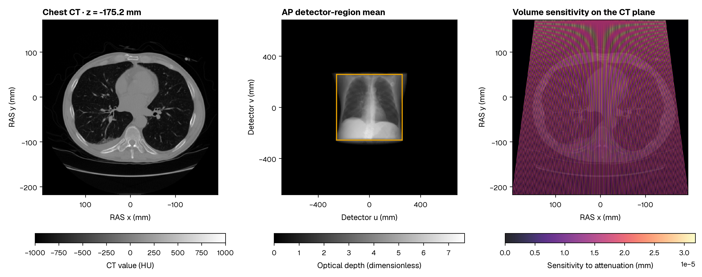

# Differentiate projections in PyTorch

`dpt.torch.Projector` is a `torch.nn.Module`. Its constructor fixes the grid, geometry, precision and sampling. Its forward accepts a resident attenuation tensor and returns `(views,rows,columns)` optical depth. Importing `dpt.torch` requires the Torch extra.

```python
import torch
import dpt
from dpt.torch import Projector

ct = dpt.read_volume("chest.nii.gz", units="HU")
mu = dpt.ct_to_attenuation(ct, energy_kev=60.0)
views = dpt.standard_views(mu.grid, ("ap", "lateral"), shape=(512, 512))
field = torch.tensor(mu.values, device="cuda", dtype=torch.float32, requires_grad=True)
projector = Projector(grid=mu.grid, geometry=views, precision="fp32", samples_per_ray=1024)
prediction = projector(field)
prediction[0, 160:352, 160:352].mean().backward()
volume_sensitivity = field.grad
```

The contiguous field uses FP32 storage in both precision modes and contains finite, nonnegative attenuation in mm⁻¹. `fp64` selects FP64 sample arithmetic and output. `fp32` uses FP32 sample arithmetic and output, with initial ray setup and the final pose chain in FP64. Field gradients retain FP32 storage. Pose gradients retain FP64 storage. The detector-region mean defines the sensitivity objective for this CT.

```bash
python examples/differentiate_projection.py chest.nii.gz --units HU --output sensitivity
```

Image and volume arrays are copied to the host only by explicit final output code. The computation and its derivatives remain device resident. Keep saved tensors unchanged until backward completes. Reset gradients before repeated optimisation steps.

## Checked calls and compilation

`Projector` registers a functional multiview operator with `torch.library`. Its registered first-order backward calls a separate functional VJP operator. Forward allocates a fresh image, and backward allocates fresh gradients. Torch saves the original field and pose tensors, including shared-pose views, so changing them before backward raises its usual version-check error.

Each forward validates the current field once and every view's pose. Backward repeats those checks and validates the complete cotangent once. Native kernels retain their own numerical checks. Checks are enqueued on the execution stream, and one aggregate status read completes each successful multiview operation. Failed calls may read individual statuses again to identify the affected views. Invalid input or unrepresentable results raise before the call returns. Diagnostic delivery occurs at the end of each forward or backward. Discard the outputs of a failed call. A subsequent valid call can reuse the module. This policy checks mutable optimisation inputs on every invocation.

Use the Inductor backend for a compiled module:

```python
compiled_projector = torch.compile(projector, backend="inductor", fullgraph=True)
field.grad = None
compiled_prediction = compiled_projector(field)
compiled_prediction[0, 160:352, 160:352].mean().backward()
```

The projection and VJP remain opaque registered operators with FakeTensor metadata implementations. Inductor compiles the surrounding tensor graph. The native calculation remains in Warp. The supported Torch dependency is `>=2.14,<3`. CUDA compilation checks cover field, pose and joint gradients in both precision modes. Initial calls can compile Torch and Warp specialisations and prepare native workspaces.

These checked operators synchronise their execution stream to deliver diagnostics and carry the `cudagraph_unsafe` tag. CUDA graph capture is unsupported. Higher-order derivatives (`create_graph=True`) are also unsupported. See the [full-scan performance and reproduction results](performance/fullscan.md) for measured call boundaries.

A bounded private cache owns native workspaces per device, calling stream and requested derivatives. The cache allows unused modules to be freed. Cone, parallel and curved detector geometry retain their physical parameters. `out=` is an inference-only path with declared output mutation. Omit it when differentiating. It must be contiguous, have the image shape and output dtype, share the field's device, and use storage separate from inputs. Call it inside `torch.no_grad()` when any input requires gradients. The returned tensor is the supplied buffer.

Native work runs on the current CUDA stream for that call. Inputs, temporary tensors and outputs retain their storage through native consumption, and cached scratch is used sequentially. If another stream produced an input, establish the usual Torch stream dependency before calling the module. Likewise, wait for a gradient-producing stream before consuming its result on another stream. The adapter uses stream-level synchronisation.

## Differentiable pose

`pose` is an FP64 tensor with shape `(6,)` or `(views,6)`: translation `(tx,ty,tz)` in mm followed by rotation tangent `(rx,ry,rz)` in radians. It is a right SE(3) tangent about the constructor's `anchor` transform. A shared six-vector applies to all views. `packed_pose` is a distinct explicit `(12,)` or `(views,12)` transform containing row-major rotation followed by translation. It overrides the anchor.

```python
pose = torch.zeros(6, device="cuda", dtype=torch.float64, requires_grad=True)
prediction = projector(field, pose=pose)
loss = prediction.square().mean()
loss.backward()
```



The highlighted AP detector region defines the mean optical-depth objective. Its derivative is mapped into the unchanged CT grid. The fine ray-weight pattern is the measured sampling transpose. Attenuation is linear in the field. The sensitivity weights follow the sampling geometry and detector objective.

For an application, replace the objective with a loss against real measured images in the same calibrated geometry and quantity.

## Optional paired-data fit

`examples/fit_pose.py` takes a measured image per calibrated view, a volume and JSON calibration. It validates RAS/mm coordinates, object-to-world pose, detector dimensions and declared optical-depth/transmission units before CUDA execution. The Torch loop saves initial/final predictions, measured overlays, the objective trace and an optimiser checkpoint.

```bash
python examples/fit_pose.py volume.nii.gz --units HU \
  --measured measured_optical_depth.npy --calibration calibration.json --output fit
```

The calibration contains `coordinate_frame: "RAS"`, `length_units: "mm"`, `pose_convention: "object_to_world"`, `image_quantity: "optical_depth"` (or `"transmission"`), `anchor` and `geometry`. Each geometry uses the [DetectorGeometry fields](reference/api-geometry.md). `anchor` supplies a proper rotation and translation.

DeepFluoro is an opt-in research dataset with its own noncommercial terms. For the pinned [dataset revision](https://huggingface.co/datasets/eigenvivek/xvr-data/tree/a17273e3eadbd793bd861f3598a80ce4590c1124/deepfluoro/subject06), inspect the metadata and convert its measured images and calibration to the required quantities.
